# 《操作系统研讨课》Lecture 2 中文精读笔记

## A Simple Kernel —— 简易内核

> **源文件**：`操作系统研讨课-Lecture 2.pdf`（48 页，2026-09-23 授课）
> **本笔记**：逐页中文翻译 + 要点讲解
> **配套材料**：`guide_book_p2.pdf`（任务书第二章，详细规格）、`P2start-code和pynq板卡启动.pdf`（取代码 + 上板）
> **生成日期**：2026-09-29

---

## 使用说明

- 本笔记按 PDF 页码顺序排列，每页给出 **📄 原文翻译** 和 **💡 讲解** 两部分。
- 课件里凡是代码片段、位图、状态机图，**都是图片**，文字层里没有。本笔记用 `` 引出了对应截图，点开即可看原图。
- 课件里的英文缩写第一次出现时，本笔记会在括号里给出中文全称。
- 讲解部分会**向外延伸**到 `guide_book_p2.pdf` 的对应章节和 start-code 的文件名，方便对照。

---

## 全局速览

这份课件是 **Project 2 的"布置课"**（第 2 页明说：Project 1 截止 + Project 2 布置）。48 页分成两大块，中间有一条**极重要的分界线**：

```
┌──────────────────────────────────────────────────────────────┐
│ P1-2    开场：日程、P1 截止、布置 P2                           │
├──────────────────────────────────────────────────────────────┤
│ P3-23   【上半场】Requirement I —— 非抢占式内核                │
│         PCB → 内核栈 → switch_to → do_scheduler → 锁 → BLOCK  │
│         对应【任务 1】【任务 2】                               │
│         ★ P23：design review 问题清单（5 问）                  │
├──────────────────────────────────────────────────────────────┤
│ P24-46  【下半场】Requirement II —— 抢占式内核                 │
│         中断/例外 → CSR → stvec/scause/sepc → 定时器 → sleep  │
│         对应【任务 3】【任务 4】【任务 5】                      │
│         ★ P46：design review 问题清单（6 问）                  │
├──────────────────────────────────────────────────────────────┤
│ P47-48  收尾：S/A/C-Core 分级要求、P2 时间表                    │
└──────────────────────────────────────────────────────────────┘
```

### 上下半场的核心区别

| | 上半场：**非抢占式** | 下半场：**抢占式** |
|---|---|---|
| 谁决定切换进程 | **进程自己**主动交出 CPU（调 `sys_yield`） | **操作系统**强行夺走 CPU（定时器中断触发） |
| 依赖机制 | 普通函数调用 `switch_to` | 硬件例外机制 + `switch_to` |
| 前提条件 | 无（普通内核态代码即可） | 必须先实现例外的保存/分发/恢复 |
| 若进程不配合 | 它会永远霸占 CPU | 无所谓，定时器到了就被换下 |

**关键认知**：抢占式**不是重写**，而是在非抢占式之上**加一层**。上半场的 `PCB`、`内核栈`、`switch_to`、`do_scheduler` 下半场全部继续沿用——任务 4 只是把 `do_scheduler` 挂到定时器中断的处理函数里。

### 核心术语速查

| 英文 | 中文 | 一句话解释 |
|---|---|---|
| Process | 进程 | 正在运行的程序；资源分配的单位 |
| PCB (Process Control Block) | 进程控制块 | 内核里描述一个进程的数据结构，进程的"身份证 + 病历本" |
| Context | 上下文 / 现场 | 进程被换下时那一刻 CPU 寄存器的全部取值 |
| Context switch | 上下文切换 | 保存当前进程现场、恢复下一个进程现场的过程 |
| Kernel stack | 内核栈 | 每个进程在内核态专属的栈，用来存放保存下来的现场 |
| Scheduler | 调度器 | 决定"接下来该谁上 CPU"的那部分代码 |
| Non-preemptive | 非抢占式 | 进程主动让出 CPU 才切换 |
| Preemptive | 抢占式 | 操作系统用中断强行打断进程 |
| Yield | 让出 | 进程主动放弃 CPU |
| BLOCK | 阻塞 | 进程在等资源，暂时不能被调度 |
| Mutex lock | 互斥锁 | 保证同一时刻只有一个进程能进临界区 |
| Critical section | 临界区 | 加锁保护起来的那段代码 |
| Exception / Trap | 例外 / 陷阱 | 程序正常执行流被打断并强制转移（中断、异常、系统调用的统称） |
| Interrupt | 中断 | 硬件发来的、要求立即处理的信号 |
| CSR | 控制状态寄存器 | RISC-V 里控制特权级行为的一类特殊寄存器 |
| Syscall | 系统调用 | 用户程序请求内核服务的正式接口 |
| Timer interrupt | 定时器中断 | 周期性触发，用于实现时间片轮转 |
| Time slice | 时间片 | 一个进程一次能连续占用 CPU 的时间 |

---

# 第一部分 · 开场（P1–P2）

---

## P1


### 📄 原文翻译

> **第 2 讲　一个简易的内核**
> 2026.09.23

### 💡 讲解

封面页。"A Simple Kernel" 是整个 Project 2 的主题——你要在 P1 那个只能"打印字符串 + 加载一个程序"的基础上，做出一个**有进程管理能力的简易内核**。"Simple" 是相对的：麻雀虽小，五脏俱全。

---

## P2


### 📄 原文翻译

> **日程**
> • Project 1 截止
> • Project 2 布置

### 💡 讲解

这一页交代了这节课的处境：**P1 今天截止，P2 今天发出**。也就是说这节课本身就是 P2 的"发题课"——老师在这一节课里把 P2 要做什么、为什么做、怎么做、代码在哪，一次性讲给你。

📌 对照 `guide_book_p2.pdf`：那份是**任务书**，是动手时的详细手册（什么文件、什么函数、什么步骤）；这份课件是**讲课稿**，是建立理解的骨架。两份配合看。

---

# 第二部分 · Requirement I：非抢占式内核（P3–P23）

> 这一段回答："**怎么让多个程序轮流跑起来？**"

---

## P3

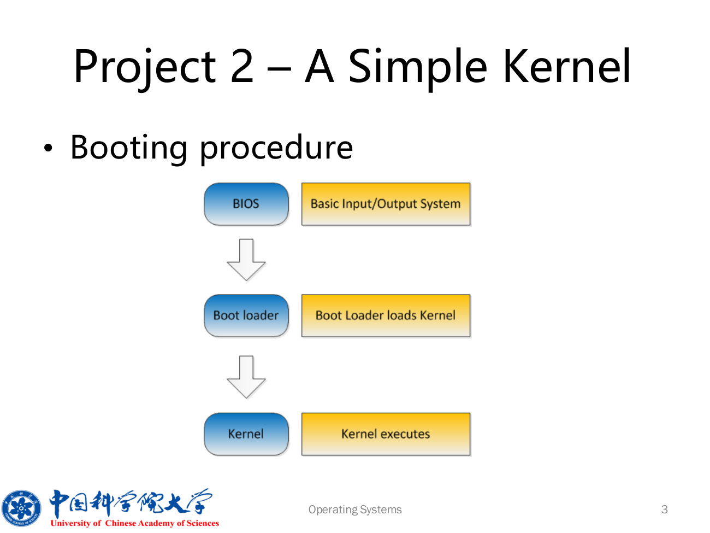

### 📄 原文翻译

> **Project 2 – 一个简易内核**
> • **引导流程**
> 　– BIOS：基本输入输出系统
> 　↓
> 　– 引导程序（Boot loader）：引导程序加载内核
> 　↓
> 　– 内核（Kernel）：内核开始执行

### 💡 讲解

**这是在复习 P1**。P2 没有改动引导流程，先把它摆出来是为了给你一个"从哪出发"的起点。

三级的职责链条：

| 阶段 | 谁在做 | 干什么 |
|---|---|---|
| BIOS (BBL) | 硬件/固件 | 上电初始化，把 SD 卡第一个扇区（512B）搬到 `0x50200000` |
| Boot loader | **你 P1 写的** | 把内核从 SD 卡搬到 `0x50201000`，跳到内核入口 |
| Kernel | **你 P1/P2 写的** | 初始化，然后……P1 只能跑一个程序，P2 要管一堆进程 |

⚠️ 记住这三个地址，P2 全程不能违反：BIOS/BBL 占 `0x50000000–0x50200000`，**内核必须在 `0x52000000` 以下**，用户程序在 `0x52000000` 以上。

---

## P4


### 📄 原文翻译

> **Project 2 – 一个简易内核**
> • **要求一**
> 　– 编写一个简易内核（**非抢占式**）
> 　　• **进程管理**
> 　　　– 启动一组进程
> 　　　– 在这些进程之间提供上下文切换，采用非抢占式调度
> 　　　– 支持基本的互斥锁，以实现进程的 **BLOCK（阻塞）状态**

### 💡 讲解

**这是上半场的总纲**，三条要求对应两个任务：

| 要求 | 对应任务 | 要写的东西 |
|---|---|---|
| 启动一组进程 | 任务 1 | PCB 初始化、内存分配 |
| 非抢占式上下文切换 | 任务 1 | `switch_to`（汇编）、`do_scheduler` |
| 互斥锁 → BLOCK 状态 | 任务 2 | `do_block`/`do_unblock`、`lock.c` |

**"非抢占式"的准确定义**：进程**不会被打断**，只有当它**主动**调用 `sys_yield`（让出）或因为等锁而阻塞时，才会发生切换。如果它写了个 `while(1);`，整个系统就卡死在那儿——这正是下半场要用抢占式解决的根本问题。

---

## P5


### 📄 原文翻译

> **Project 2 – 一个简易内核**
> • **一组用户进程**
> 　– print1、print2、flyer（飞行器）
> 　– 请**先阅读**这些不同任务（测试程序）的代码，理解它们在做什么

### 💡 讲解

start-code 会给你几个测试程序当"靶子"：

| 程序 | 行为 | 用途 |
|---|---|---|
| `print1` / `print2` | 在屏幕上**交替**打印 `This task is to test scheduler` | 验证两个进程能轮流上 CPU |
| `fly`（flyer） | 在屏幕上画一架飞机，并**从左向右不断移动** | 验证调度是否"看起来在同时跑" |

⚠️ 课件特意强调"**请先阅读它们的代码**"。这些用户程序是验证你内核正确性的唯一标准——不读懂它们，你调试时根本不知道该期待什么输出。

📌 任务书还给了个硬指标：`print1` 和 `print2` 的**计数器进度应该基本一致**，不能一个涨得飞快、另一个几乎不动。这就是在检查你调度得均不均衡。

---

## P6


### 📄 原文翻译

> **Project 2 – 一个简易内核**
> • **进程控制块（PCB）**
> 　– 操作系统内核中**驻留于内存**的一种数据结构，存放用于管理一个进程的信息
> 　– 请参考已给出的 `pcb_t` 定义（`include/os/sched.h`）

### 💡 讲解

**这是 P2 的第一个核心概念。**

进程本身是个抽象概念——内核看不见"一个进程"，它只看得到 PCB。**PCB 是进程在内核里唯一的实体代表**，是内核感知进程的唯一通道。

类比：进程是"一个人"，PCB 是"这个人的档案"。内核要调度的时候，不直接碰程序，而是翻档案、改档案、按档案切换。

📌 **文件名去确认一下**：`include/os/sched.h`。任务书里也反复提这个路径，说明它是 P2 改造的主战场之一。

---

## P7

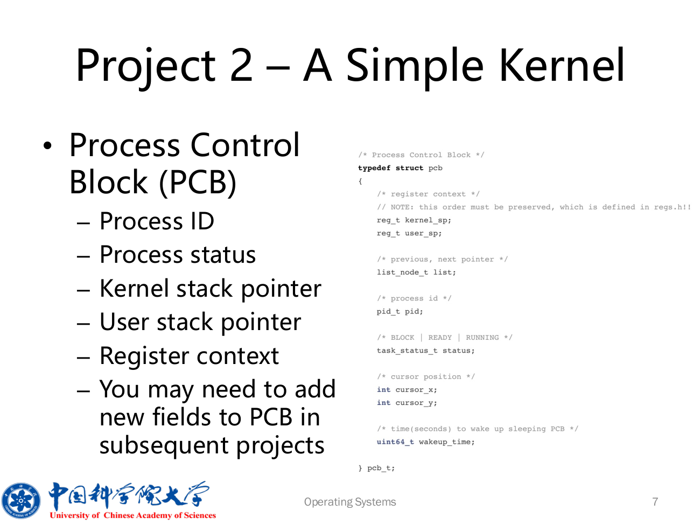

### 📄 原文翻译

> **Project 2 – 一个简易内核**
> • **进程控制块（PCB）**
> 　– 进程 ID
> 　– 进程状态
> 　– 内核栈指针
> 　– 用户栈指针
> 　– 寄存器上下文
> 　– 在后续的 Project 中，你可能需要给 PCB 添加新的字段

**右侧代码**（截图，见原图）：

```c
/* Process Control Block */
typedef struct pcb
{
    /* register context */
    // NOTE: this order must be preserved, which is defined in regs.h!!
    reg_t kernel_sp;
    reg_t user_sp;

    /* previous, next pointer */
    list_node_t list;

    /* process id */
    pid_t pid;

    /* BLOCK | READY | RUNNING */
    task_status_t status;

    /* cursor position */
    int cursor_x;
    int cursor_y;

    /* time(seconds) to wake up sleeping PCB */
    uint64_t wakeup_time;
} pcb_t;
```

### 💡 讲解

**逐字段拆解**：

| 字段 | 类型 | 作用 | 什么时候用 |
|---|---|---|---|
| `kernel_sp` | `reg_t` | **内核栈指针**——指向该进程保存在内核栈上的现场 | `switch_to` 保存 / 恢复现场 |
| `user_sp` | `reg_t` | **用户栈指针**——该进程在用户态用的栈 | 从内核返回用户态时恢复 |
| `list` | `list_node_t` | 链表节点，用来把 PCB 挂进各种队列 | 就绪队列、睡眠队列、锁的等待队列 |
| `pid` | `pid_t` | 进程号，标识身份 | 调试、区分进程 |
| `status` | `task_status_t` | `BLOCK` / `READY` / `RUNNING` | 调度器据此决定谁能被选中 |
| `cursor_x`, `cursor_y` | `int` | 该进程的光标位置 | 每个进程独立记住自己打到屏幕哪儿了 |
| `wakeup_time` | `uint64_t` | 睡眠到期的时间点（秒） | 任务 3 的 `do_sleep` 用 |

⚠️ **代码里那句注释极其重要，也极容易被追问**：

> `// NOTE: this order must be preserved, which is defined in regs.h!!`

意思是 `kernel_sp` / `user_sp` 这两个字段的**先后顺序不能改**，因为它和 `regs.h` 里定义的现场布局是对应的。汇编代码（`switch_to`、`SAVE_CONTEXT`）会按固定偏移量去访问 PCB 字段，改顺序就全错位了。

📌 **`list` 字段的设计意义**：让**同一个 PCB 结构体**能根据状态被挂到不同的队列里（就绪队列 / 睡眠队列 / 某个锁的等待队列），而不需要为每种队列定义不同的节点结构。这是任务 2 里"进程被阻塞后挂到哪里"的关键。

📌 **`cursor_x/y` 的设计意义**：为什么不放在全局变量里？因为多个进程在同时往屏幕上写——每个进程得有**自己**的光标记忆，否则互相踩踏，屏幕上会乱成一团。

---

## P8


### 📄 原文翻译

> **Project 2 – 一个简易内核**
> • **初始化 PCB**
> 　– 为被测进程初始化 PCB
> 　　• 分配 ID，设置 `status` / `cursor_x` / `cursor_y`
> 　　• PCB 可以用**链表**组织起来
> 　– 为内核栈和用户栈分配内存
> 　　• 请使用 `allocKernelPage` / `allocUserPage` 函数（`kernel/mm/mm.c`）

### 💡 讲解

**初始化 PCB 的四个动作**：

1. 分配 PCB 结构体本身
2. 填 `pid`、`status = READY`、`cursor_x/y`
3. 把 PCB 挂进链表（将来要放进就绪队列）
4. **为它分配两块栈**：内核栈 + 用户栈

**为什么一个进程要两块栈？**

| | 用户栈 | 内核栈 |
|---|---|---|
| 什么代码在用 | 用户态代码 | 内核态代码 |
| 为什么需要 | C 程序运行必须有栈 | 内核是系统的管理者和服务者，**必须有比普通进程更高的权限和独立的运行空间**，避免安全问题 |

📌 任务书 3.3 节专门讲了内核栈的两种设计：
- **单内核栈**：所有进程进内核时共用同一个栈。省内存，但陷内核的代码必须整段原子执行、不能被中断。
- **多内核栈**：每个进程一个独立内核栈。**本课程框架采用这个**（xv6 用的是另一种）。

任务书原话："以 Linux 为代表的具有可抢占内核的系统基本上都采用了这种设计。"

📌 **函数名去代码里对**：`allocKernelPage` / `allocUserPage`，都在 `kernel/mm/mm.c`。

---

## P9

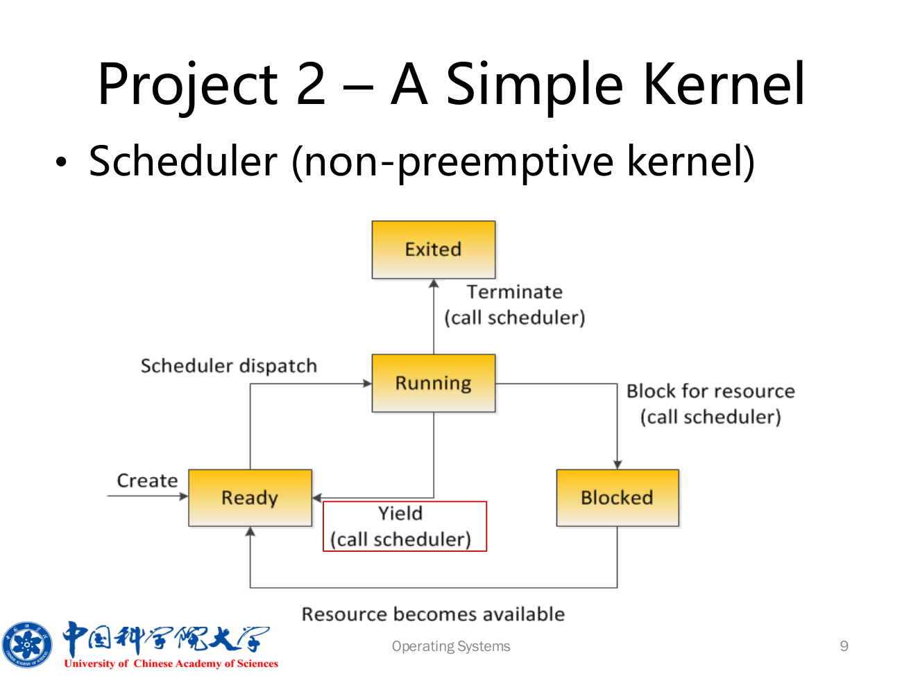

### 📄 原文翻译

> **Project 2 – 一个简易内核**
> • **调度器（非抢占式内核）**

图中是**进程状态机**：

```
                    Terminate
                  (call scheduler)
        Exited ←───────────────────┐
                                   │
                       ┌───────────┴──────────┐
   Create              │       Running        │
    ──────→  Ready ←───┤                      │
             ↑   ↑     └───────┬──────────────┘
             │   │             │
             │   │  Scheduler  │  Block for resource
             │   │  dispatch   │  (call scheduler)
             │   │             ↓
             │   │         ┌────────┐
             │   └─────────│ Blocked│
             │   Resource  └────────┘
             └───becomes available
             │
        Yield (call scheduler)
```

（图中 `Yield (call scheduler)` 被红框标出，表示这是**本阶段要重点实现**的一条边）

### 💡 讲解

**这是整个上半场的"地图"**。五个状态、六条迁移：

| 迁移 | 触发者 | 说明 |
|---|---|---|
| Create → Ready | 内核初始化 | 进程被创建出来，进入就绪队列 |
| Ready → Running | **Scheduler dispatch** | 调度器选中它，让它上 CPU |
| Running → Ready | **Yield（让出）** | 进程**主动**说"我不用了"——红框重点 |
| Running → Exited | Terminate | 进程结束（本课程里进程不退出，暂时用不上）|
| Running → Blocked | Block for resource | 进程申请不到资源（比如抢不到锁），主动去睡 |
| Blocked → Ready | **Resource becomes available** | 资源来了，把它唤醒放回就绪队列 |

⚠️ **两个关键观察**：

1. **红框只有 `Yield` 一条边**：这说明任务 1 只要实现"进程主动让出"，`Blocked` 那条路是任务 2 的事。
2. **注意括号里的 `(call scheduler)`**：图上有三条边都标了这个——`Yield`、`Terminate`、`Block`。这揭示了一个统一的设计：**所有状态变化最终都通过调用调度器 `do_scheduler()` 来完成**。进程状态改变 ≠ 立刻切换，而是"改状态 → 调调度器 → 调度器决定下一个是谁"。这个设计很干净，理解它，任务 2 的 `do_block` 就顺理成章了。

---

## P10


### 📄 原文翻译

> **Project 2 – 一个简易内核**
> • **让出（Yield）**
> 　– 一个进程**自己**通过调用内核调度器，交出对 CPU 的控制权
> 　– 内核调度器把当前正在运行的进程放到**就绪队列的末尾**，然后挑选另一个进程来运行
> 　– 请参考 `kernel_yield()` 函数

### 💡 讲解

**这是"非抢占式调度"的全部机制**，一句话讲完：

> 进程主动说"我不用了" → 调度器把它排到队尾 → 从队头挑下一个。

这就是**轮转调度（Round Robin, RR）**的最朴素形态——**FIFO + 用完排到队尾**。

📌 **`kernel_yield()` 是个关键入口**。用户在用户态调用的是 `sys_yield()`，但任务 1/2 阶段还没有真正的系统调用，所以走的是"跳转表"过渡方案（见任务书任务 1 的注意事项 1）。等到任务 3 实现了真正的系统调用，这条路径才会被替换成 `ecall`。

⚠️ **为什么非抢占式必须先实现？** 因为非抢占式**只需要**：PCB + 现场保存/恢复 + 调度函数。没有中断、没有 CSR、没有特权级切换，是本项目里最简单的一环。先把它做出来，下半场才有地基。

---

## P11

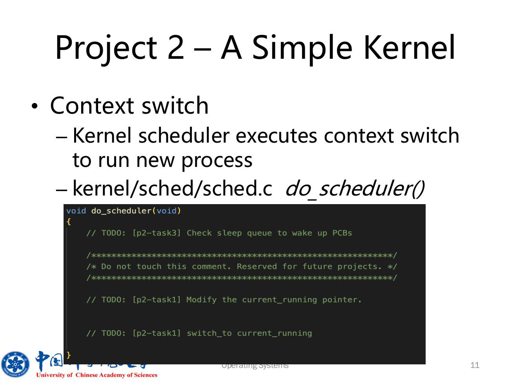

### 📄 原文翻译

> **Project 2 – 一个简易内核**
> • **上下文切换**
> 　– 内核调度器执行上下文切换，以运行新进程
> 　– `kernel/sched/sched.c` 中的 `do_scheduler()`

**下方代码**（截图，见原图）：

```c
void do_scheduler(void)
{
    // TODO: [p2-task3] Check sleep queue to wake up PCBs

    /**********************************************************************/
    /* Do not touch this comment. Reserved for future projects.           */
    /**********************************************************************/

    // TODO: [p2-task1] Modify the current_running pointer.

    // TODO: [p2-task1] switch_to current_running
}
```

### 💡 讲解

**这是调度器的骨架，也是任务 1 的核心交付物之一。**

骨架里的三个 TODO 直接把任务顺序告诉你了：

| TODO 标记 | 属于哪个任务 | 要做什么 |
|---|---|---|
| `[p2-task3]` | 任务 3 | 检查睡眠队列，唤醒到期的 PCB |
| `[p2-task1]` | 任务 1 | 修改 `current_running` 指针 |
| `[p2-task1]` | 任务 1 | `switch_to` 到 `current_running` |

⚠️ 还有一条中间那个 `Do not touch this comment. Reserved for future projects.` —— 这是助教给后续 Project（P3 及以后）预留的锚点，**不许删改**。这种"给未来的自己留接口"的做法在系统编程里很常见。

📌 **`current_running` 是什么？** 一个**全局 PCB 指针**，指向当前正在运行的进程。整个内核靠它来回答"现在是谁在跑？"。它的重要性怎么强调都不过分——任务书原话："我们实际上只需要一个全局的 PCB 指针 `current_running`，它指向哪个 PCB，说明那个 PCB 对应的任务为正在运行的任务。"

---

## P12


### 📄 原文翻译

> **Project 2 – 一个简易内核**
> • **上下文切换**
> 　– **保存现场**
> 　　• CPU 寄存器 → 内核栈（在内存中）
> 　– **恢复现场**
> 　　• 内核栈 → CPU 寄存器

### 💡 讲解

**这两句话是整章的枢纽**，值得逐字读。

核心矛盾：**CPU 只有一套寄存器，但有很多个进程**。

寄存器是硬件资源，不能同时被多个进程占有。所以：

- 进程 A 要下 CPU 时 → 把 CPU 里**所有它关心的寄存器值**抄写到**内存**（它的内核栈）里，把 CPU 交出去
- 将来 A 要重新上 CPU 时 → 把这些值从内存**抄回** CPU 寄存器，A 就像没停过一样继续跑

⚠️ **这正是教程 3.2 节讲的"资源管理"问题的具体体现**：CPU 上的 GPR（通用寄存器）、CSR（控制状态寄存器）都是共享硬件资源，**进程之间不共享的寄存器必须"保留到内存中，待此进程再次被调度至某一 CPU 上运行时再取出并使用"**。

📌 注意这里说的是"**内核栈**"，不是 PCB。教程说明了两处都可以存：
> "操作系统就会将当前正在运行进程的现场保存到栈中（当然也可以是 PCB 当中，如果你想要更改这里的实现，可以自行对框架做出改动）"

框架选的是**栈**。好处是：PCB 只存一个 `kernel_sp` 就够了——**栈指针本身就是"现场在哪里"的答案**。

---

## P13

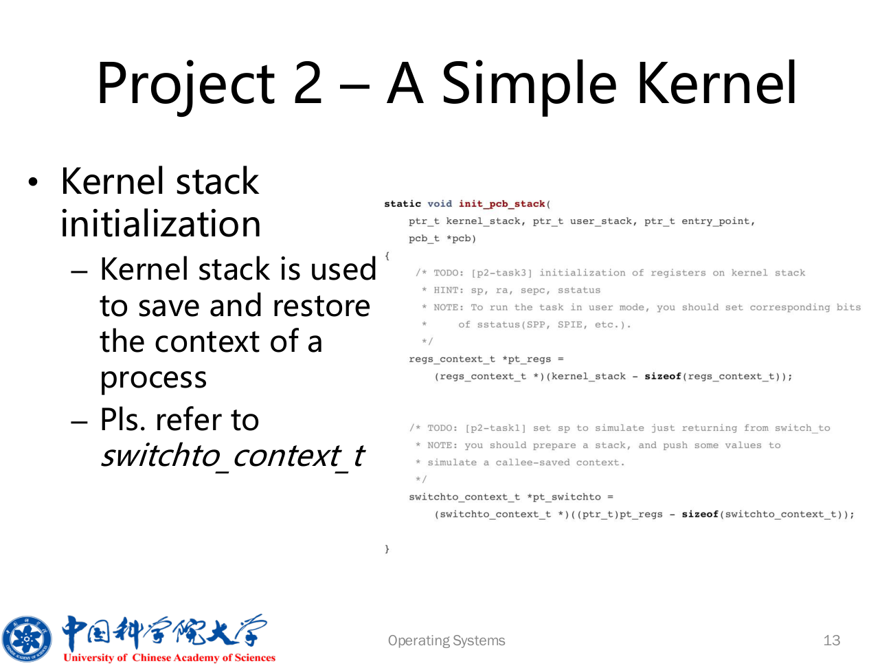

### 📄 原文翻译

> **Project 2 – 一个简易内核**
> • **内核栈初始化**
> 　– 内核栈被用来保存和恢复一个进程的上下文
> 　– 请参考 `switchto_context_t`

**下方代码**（截图，见原图）：

```c
static void init_pcb_stack(
    ptr_t kernel_stack, ptr_t user_stack, ptr_t entry_point,
    pcb_t *pcb)
{
    /* TODO: [p2-task3] initialization of registers on kernel stack
     * HINT: sp, ra, sepc, sstatus
     * NOTE: To run the task in user mode, you should set corresponding bits
     *          of sstatus(SPP, SPIE, etc.).
     */
    regs_context_t *pt_regs =
        (regs_context_t *)(kernel_stack - sizeof(regs_context_t));

    /* TODO: [p2-task1] set sp to simulate just returning from switch_to
     * NOTE: you should prepare a stack, and push some values to
     * simulate a callee-saved context.
     */
    switchto_context_t *pt_switchto =
        (switchto_context_t *)((ptr_t)pt_regs - sizeof(switchto_context_t));
}
```

### 💡 讲解

**这一页是任务 1 的技术核心。** 读懂它就懂了 `switch_to` 为什么能工作。

### 内核栈的布局

代码里两个指针的算法直接暴露了布局：

```
     kernel_stack  ← allocKernelPage 返回的栈顶（高地址）
        ┌────────────────────────────────────┐
        │         regs_context_t             │ ← pt_regs
        │  （全量寄存器 + 部分 CSR）           │   标记 [p2-task3]
        │  用于"用户态 → 内核态"的现场保存      │
        ├────────────────────────────────────┤ ← pcb->kernel_sp 指向这里
        │       switchto_context_t           │ ← pt_switchto
        │  （callee-saved 寄存器）            │   标记 [p2-task1]
        │  用于"进程 A → 进程 B"的现场保存      │
        ├────────────────────────────────────┤
        │                                    │
        │        ↓ 运行时可用的栈空间          │
        └────────────────────────────────────┘
                    低地址
```

**为什么是两块？** 因为进程切换要**保存两次现场**（任务书 5.5 节专门讲了）：

1. **用户态陷入内核态**时 → 保存**全量**通用寄存器 + 部分 CSR → 存进 `regs_context_t`
2. **内核态里做进程切换**时 → 只需保存 **callee-saved** 寄存器 → 存进 `switchto_context_t`

⚠️ **为什么任务 1 就要给 `regs_context_t` 留出位置，哪怕用不上？**
因为框架**一开始就把栈的布局定死了**：`kernel_sp` 必须是 `pt_switchto` 的位置，而 `pt_regs` 在它上面。任务 3 之后要往 `pt_regs` 里写东西，如果任务 1 不留位置，布局就变了，所有偏移量全错。**先定布局、后填内容**，这是系统编程的标准做法。

### 一个必须理解的难题：新进程的"假现场"

`[p2-task1]` 那段注释是全章最精妙的地方：

> `set sp to simulate just returning from switch_to`
> （设置 sp，**模拟刚刚从 switch_to 返回**）
> `you should prepare a stack, and push some values to simulate a callee-saved context`
> （准备一个栈，压入一些值来**伪造一个 callee-saved 现场**）

**问题**：所有进程切换都是"从 `switch_to` 里被保存/被恢复"的。但一个**新建的** PCB 从没调用过 `switch_to`，它栈上**根本没有现场**可恢复！

**答案**：手工伪造一个。在 `init_pcb_stack` 里往栈上摆一个假的 `switchto_context_t`：

- 把它的 **`ra` 设成进程的入口地址** `entry_point`
- 把它的 **`sp` 设成用户栈** `user_stack`

这样当 `switch_to` 干完活执行最后那句 `jr ra` 时，它以为自己"返回"了——**实际上跳到了新进程的第一条指令**。新进程就此诞生。

📌 这对应教程 3.5 节的两种做法，框架选的是第 1 种"制作一个假的现场"：
> "制作一个假的现场，即 PCB 在初始化的过程中将一个假的现场放在栈上，供进程切换的时候使用，而这个假现场中就包含这个入口地址，从而在第一次执行的时候从假的现场中恢复执行。"

📌 `[p2-task3]` 的 `HINT: sp, ra, sepc, sstatus` 是任务 3 要填的，`NOTE` 里那句"要设置 sstatus 的 SPP、SPIE 位才能让任务运行在用户态"是任务 3 的关键——先记着，后面 P34 会讲。

---

## P14


### 📄 原文翻译

> **Project 2 – 一个简易内核**
> • **`switch_to` 函数**
> 　– 工作起来像一次函数调用，但**调用返回时，返回地址指向的是另一个进程**
> 　– 在 `switch_to` 中，先保存上一个进程的进程上下文，然后恢复下一个进程的进程上下文
> 　– 进程上下文放在哪里？　• **内核栈**

### 💡 讲解

**这是 P2 最反直觉、也最容易被追问的概念。**

普通函数：`A` 调用 `f()`，`f()` 里的 `ret` 回到 `A` 调用点的下一行。
`switch_to`：`A` 调用它，**返回时却是 `B` 在跑**。

而且更奇妙的是：将来某一天 `B` 被换下去了，`A` 又会被调度回来，CPU 会**从 `A` 当初调用 `switch_to` 的那一行继续往下执行**。对 `A` 来说，它完全不知道中间发生过什么，只是"感觉 `switch_to` 这个函数调用花了一会儿时间才返回"。

📌 教程的比喻很生动：
> "进程 A 相当于被'蒙上了双眼'，并不知道在调用此函数后发生了什么，只是以为在调用之后返回而已。"

📌 教程还强调了这个概念的独特性：
> "任务切换实际上是一种**程序修改自身运行环境和状态**的行为，是操作系统内核独有的一种行为，在其他应用场景很少会遇到。"

**怎么做到的？** 关键洞察是：**`ra`（返回地址寄存器）是存在栈上的，而每个进程有自己的内核栈**。所以"返回地址"这个概念本身是**每个进程私有的**——切了栈，就等于切了"接下来要执行哪"。

📌 **答题时的加分点**：主动说"不一定非得叫 `switch_to`，但**无论如何一定有一个函数具有这样的特性：在进入和离开这个函数的时刻，正在运行的进程是不同的**。"（教程原文）这说明你理解了本质而不是记了个函数名。

---

## P15

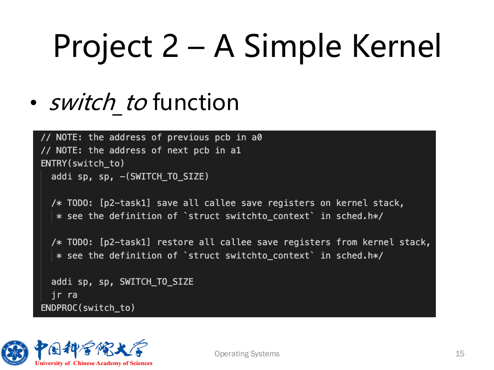

### 📄 原文翻译

**代码**（截图，见原图）：

```asm
// NOTE: the address of previous pcb in a0
// NOTE: the address of next pcb in a1
ENTRY(switch_to)
    addi sp, sp, -(SWITCH_TO_SIZE)

    /* TODO: [p2-task1] save all callee save registers on kernel stack,
     * see the definition of `struct switchto_context` in sched.h*/

    /* TODO: [p2-task1] restore all callee save registers from kernel stack,
     * see the definition of `struct switchto_context` in sched.h*/

    addi sp, sp, SWITCH_TO_SIZE
    jr ra
ENDPROC(switch_to)
```

### 💡 讲解

**这就是任务 1 要写的那个汇编函数。** 骨架已经把答案的形状给出来了。

### 参数约定（课件顶部两行注释）

- `a0` = **上一个** PCB 的地址（previous）
- `a1` = **下一个** PCB 的地址（next）

### 骨架的结构说明了什么

```
addi sp, sp, -(SWITCH_TO_SIZE)     ← ① 在栈上开一块 space 放 switchto_context_t
   ... 保存 callee-saved 到这块 space ...
   ... 从下一进程的栈恢复 callee-saved ...
addi sp, sp, SWITCH_TO_SIZE        ← ② 收回这块 space
jr ra                              ← ③ 这个 ra 已经是"下一个进程的"了
```

### 逻辑链条（任务 1 要自己补出来的部分）

```
① 把 A 的 callee-saved 寄存器存到 A 的内核栈（sp 当前指向 A 的栈）
② 把当前 sp 存进 A 的 PCB.kernel_sp        ← "A 的现场在这里"
③ 从 B 的 PCB.kernel_sp 取出 B 上次保存的 sp，赋给 sp  ← 切栈
④ 从 B 的内核栈里恢复 B 的 callee-saved 寄存器
⑤ addi sp, sp, SWITCH_TO_SIZE ; jr ra      ← "返回"到了 B 的世界
```

⚠️ **两个必须答得出来的设计理由**

**（1）为什么只存 callee-saved，不存全部 32 个寄存器？**

因为 `switch_to` 是内核**主动调用的普通函数**，遵循 C 的调用约定（ABI）：

- **caller-saved**（`t0–t6`、`a0–a7`）：调用者负责。**编译器在调用 `switch_to` 之前就已经把它们保存到栈上了**，`switch_to` 内部不用管。
- **callee-saved**（`s0–s11`、`sp`、`ra`）：被调用者负责，`switch_to` 必须自己存。

📌 教程原话：
> "是 ABI 对 GPR 的使用约定，使得 `switch_to` 函数调用后需要保存的现场只占了 32 个 GPR 的一部分。"

📌 教程任务 1 注意事项 2 补充了更精确的说法：
> "所有需要由调用者保存的寄存器在函数调用前都已经保存在栈上了，`switch_to` 中只需要保存所有应该由被调用者保存的寄存器即可。"

**（2）`SWITCH_TO_SIZE` 是什么？** 就是 `sizeof(switchto_context_t)`，与 PCB 里的现场布局严格对应。**它定义在 `sched.h` 里——去确认一下确切值。**

⚠️ **最容易被抓的坑：`tp` 寄存器**
任务书任务 1 步骤 2 明确警告：
> "请在调用 `switch_to` 时保证，**`tp` 寄存器中保存的内容为 `current_running`**。代码的其他部分假定了 `tp` 和 `current_running` 是等价的。"

框架把 `tp`（x4，thread pointer）征用来指向当前 PCB，这样保存 sp 时一句 `sd sp, OFFSET(tp)` 就够了。但也因此，**`tp` 和 `current_running` 的同步时机是个雷区**——如果更新顺序错了，就会把 A 的现场错存到 B 的 PCB 里。

---

## P16


### 📄 原文翻译

> **Project 2 – 一个简易内核**
> • **启动一个进程**
> 　– 初始化之后，内核调用 `do_scheduler()`

### 💡 讲解

初始化完成后，控制流交给调度器，调度器把 CPU 交给第一个进程——**从此内核就"活"起来了**。

📌 内核的 `main()` 里大概会看到这样的结构：

```c
void main() {
    // 1. 各种初始化
    // 2. 初始化所有测试进程的 PCB
    // 3. 进入调度循环
    while (1) {
        do_scheduler();
    }
}
```

⚠️ 课件特意用两页（P16、P17）讲"启动一个进程"，是因为这里有**两个非平凡的难点**：
1. 调度器怎么"选"下一个（P17）
2. 第一次调度时**没有当前进程**（P18）

---

## P17


### 📄 原文翻译

> **Project 2 – 一个简易内核**
> • **启动一个进程**
> 　– 你需要在 `do_scheduler` 中选择一个要运行的新进程
> 　　• **FIFO 是一种首选的调度算法**
> 　　• 在 `do_scheduler()` 中，调用 `switch_to` 来在当前运行的进程和新进程之间执行上下文切换

### 💡 讲解

**"FIFO is a preferred scheduling algorithm"** 这里的 FIFO 就是**轮转（RR）**的意思——把就绪队列当队列用：从队头取、用完排到队尾。

📌 任务书 3.6 节给了更明确的建议：
> "为了简化大家的实现，这里建议大家采用最朴素的**轮转调度算法（RR, Round Robin）**：将所有处于 READY 状态的进程直接放入到准备队列中，每次取出队头作为 `current_running`。发生进程轮转时，如果 `current_running` 仍然是 READY 状态，就再放回准备队列。"

⚠️ **注意"如果 `current_running` 仍然是 READY 状态"这个条件**——如果当前进程的状态已经变成了 `BLOCK`（它在等锁），就**不能**放回就绪队列，否则它会被反复调度却什么都干不了。这正是任务 2 里"阻塞的进程去哪了"的伏笔。

📌 **关于队列的实现**（任务书 3.7 节）：start-code 只给了 `list.h` 里的数据结构，**没给队列操作函数**，要你自己基于链表写一个队列库。教程说这是数据结构课的基本功。

---

## P18


### 📄 原文翻译

> **Project 2 – 一个简易内核**
> • **启动一个进程**
> 　– 注意，当你启动**第一个**进程时，**并不存在任何当前正在运行的用户进程**，你该如何处理这种情况？
> 　　• 请参考 `pid0_pcb`（`include/os/sched.h`）
> 　　• 它可以用来存放**内核进程**的上下文（`main.c`）

### 💡 讲解

**这是一个必问的经典陷阱题。**

**问题**：`switch_to` 的工作方式是"把当前进程的现场存进当前 PCB，再从下一个 PCB 恢复"。可是**第一次**调用 `do_scheduler()` 时，根本没有"当前用户进程"——`current_running` 指谁？如果它是个空指针，第一步保存就崩了。

**答案**：`pid0_pcb`，一个**专为内核自己准备的假 PCB**。

它存在的三个理由：

1. **兜底**：`switch_to` 无条件地"把现场存进 `tp` 指向的 PCB"。有了 `pid0_pcb`，第一次切换时有地方可存，不会空指针。
2. **代表内核进程**：内核的 `main()` 本身也可以看作一个"进程"（教程说：*"我们可以认为此时操作系统已经拥有了一个'内核进程'"*）。P1 时代打印 `Hello OS!`、跳去执行用户程序，都是在这个内核进程里跑。
3. **回家的路**：所有用户进程都结束（或被阻塞）后，控制流还能切回 `pid0_pcb`，回到内核的调度循环。

📌 任务书 3 节开头讲得很明白：
> "在进入到 kernel 的 `main` 函数后……我们可以认为此时操作系统已经拥有了一个'内核进程'。即使这时已经可以运行用户程序的代码，我们实际上都是在这个内核进程内，并没有切换到一个新的用户进程中去。我们需要进行进程控制块初始化、任务切换这两步后，才可以开始运行一个新的进程。"

⚠️ **答题时的加分点**：顺带说明"`pid0_pcb` 的 `kernel_sp` 也有对应的栈上现场，只不过它的现场是内核 `main` 调到 `do_scheduler` 那一刻的真实现场，不是伪造的"。这体现了你理解它不是特例、而是同一机制的自然延伸。

---

## P19

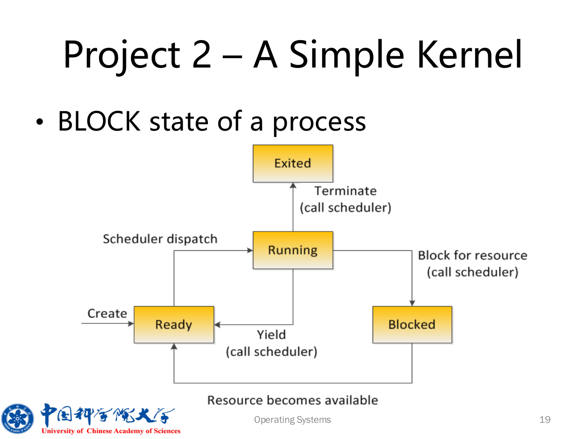

### 📄 原文翻译

> **Project 2 – 一个简易内核**
> • **进程的 BLOCK（阻塞）状态**

（图中的状态机与 P9 相同，但此次红框**被去掉了**——`Yield` 不再是重点）

### 💡 讲解

**同一张图讲第二遍，重点转移了**：这次要看的是 **Blocked** 那一块。

| 迁移 | 含义 | 需要实现什么 |
|---|---|---|
| Running → Blocked | 进程申请不到资源（例如抢锁失败），**主动**去睡 | `do_block()`：改状态为 BLOCK，从就绪队列摘掉，挂到某个等待队列，然后调 `do_scheduler()` 换人 |
| Blocked → Ready | 资源可用了，把进程唤醒 | `do_unblock()`：改状态为 READY，挂回就绪队列 |

⚠️ **BLOCK 是"主动"不是"被抢占"**：进程是**自己**发现拿不到锁才去睡的，不是被操作系统踢下去的。这一点在讲到任务 4 的抢占式调度时要严格区分开。

📌 **BLOCK 与 Yield 的本质区别**：
- **Yield**：我现在能跑，但我愿意让给别人 → 我应该**回到就绪队列**排队等着
- **Block**：我现在**跑不了**（缺资源）→ 我不该占着就绪队列的位置，应该去**等待队列**睡觉

这个区别是整个任务 2 的立足点。

---

## P20

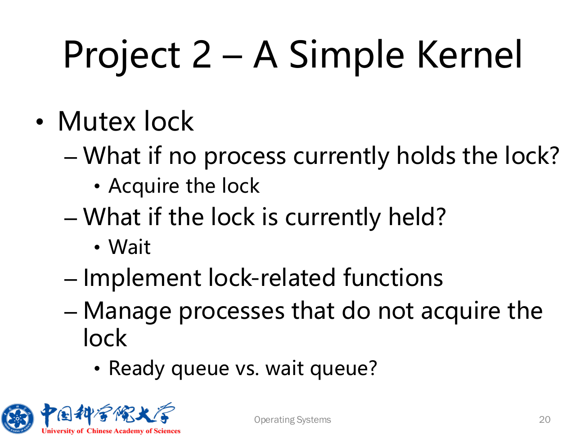

### 📄 原文翻译

> **Project 2 – 一个简易内核**
> • **互斥锁**
> 　– 如果当前没有任何进程持有这把锁，怎么办？
> 　　• 获得锁
> 　– 如果锁当前已被持有，怎么办？
> 　　• **等待**
> 　– 实现与锁相关的函数
> 　– 管理那些没能获得锁的进程
> 　　• **就绪队列 vs. 等待队列？**

### 💡 讲解

**互斥锁的两条分支**：

```
进程申请锁
   ├─ 锁是空闲的 → 拿到锁，继续跑
   └─ 锁被别人占着 → 进程进入 BLOCK 状态，去睡
                        （存进"等待队列"，而不是"就绪队列"）
```

⚠️ **最后那个问句"就绪队列 vs. 等待队列？"是留给你的思考题，也是任务 2 的核心设计点**：

- **就绪队列（ready queue）**：里面的进程**随时能跑**，只是还没轮到
- **等待队列（wait queue）**：里面的进程**现在不能跑**（在等锁或等时间），调度器**绝对不能**碰它们

把 BLOCK 的进程错误地放进就绪队列，症状是：那个进程被反复调度却每次都什么都干不了，屏幕上一片死寂，而其他进程的进度被白白拖慢。

📌 **为什么需要锁？** 任务书 4 节解释了动机：
> "当两个进程需要对同一个数据进行访问时，如果没有锁的存在，非原子性的操作同时进行就会造成不可预见的问题，可能出现第一个进程修改了一半后，第二个进程继续在第一个进程修改完的基础上进行修改的情况。"

⚠️ **锁的两种实现（任务书 4.1/4.2）**：

| | 自旋锁 (spinlock) | 互斥锁 (mutex) |
|---|---|---|
| 抢不到锁时 | `while` 循环**反复重试** | **挂起**到阻塞队列，不再被调度 |
| CPU 开销 | 浪费 CPU（空转） | 节省（睡觉不耗 CPU） |
| 本课程要求 | — | **要实现这个** |

📌 **关键设计约束**（任务书 4.3 注意事项 1）：因为进程之间地址空间是分开的（真正的隔离要到 P4 启用虚存才彻底），**两个进程无法在同一地址空间里共用同一把锁**。所以锁必须**作为内核资源管理**：
- 用户程序用 **`key`** 定位到内核里的一把具体锁
- 初始化后得到一个 **handle（句柄）**
- 之后用这个 handle 去获取/释放

这个"key → handle"的映射设计是任务 2 里最容易被追问的地方。

---

## P21


### 📄 原文翻译

> **Project 2 – 一个简易内核**
> • **循序渐进 – 任务 1**
> 　– 为被测进程初始化 PCB
> 　– 实现 `do_scheduler` 和 `switch_to`
> 　– 启动被测进程，并支持这些进程之间的上下文切换，使内核成为一个**非抢占式内核**

### 💡 讲解

任务 1 的三个交付物，正好对应 P7 / P11+P15 / P11 三页。

📌 **验收标准**（任务书 3.8）：同时运行 `print1`、`print2`、`fly`，能正确输出。其中：
- `print1`、`print2` 在屏幕上方**交替**打印 `This task is to test scheduler`
- `fly` 在屏幕上画飞机并**从左向右不断移动**
- **`print1` 与 `print2` 后计数器的计数进度应该基本一致**（不能一个很多、一个很少）

📌 **任务 1 里要动 5 个地方**（任务书步骤）：
1. `sched.h` — PCB 结构体设计
2. `main.c` — `init_pcb`
3. `entry.S` — `switch_to`
4. `sched.c` — `do_scheduler`
5. `tiny_libc/syscall.c` — `sys_yield`、`sys_move_cursor`、`sys_write`、`sys_reflush` 的**跳转表简易版**

⚠️ **本阶段的一个前提认知**：任务 1/2 里，**内核和用户程序还在同一个特权级**（都是 Supervisor），系统调用是通过**跳转表**直接函数调用，**不是真正的系统调用**。要等任务 3 才引入特权级分离。

---

## P22


### 📄 原文翻译

> **Project 2 – 一个简易内核**
> • **循序渐进 – 任务 2**
> 　– 实现互斥锁，以支持 BLOCK 状态

### 💡 讲解

任务 2 的交付物：

| 文件 | 要实现的函数 |
|---|---|
| `sched.c` | `do_block`、`do_unblock` |
| `lock.c` | `init_locks`、`do_mutex_lock_init`、`do_mutex_lock_acquire`、`do_mutex_lock_release` |
| `tiny_libc/syscall.c` | 锁相关调用的跳转表简易版 |

📌 **验收标准**：跑 `lock1`、`lock2`，两个任务**轮流抢占锁**：
- 抢占成功 → 打印 `Hash acquired lock and running`
- 抢占不成功 → 打印 `Applying for a lock`（表示还在等）

📌 **一段很值得琢磨的注意事项**（任务书 4.3 注意事项 2）：
> "一个任务执行 `do_block` 时因为被阻塞，需要切换到其他的任务，因此涉及到**任务的切换**，需要保存现场，重新调度，恢复现场。"

也就是说，**`do_block` 内部要调用 `do_scheduler`**——阻塞不是简单改个状态就完了，而是要真的把 CPU 交出去。这意味着 `do_block` 的调用栈会被"冻在半空中"，直到这个进程被唤醒的那一天才继续往下走。

📌 **一个有意思的开放设计**（任务书 4.2）：
> "并未规定是否可以释放别人占有的锁。一个合理的操作应当是无法释放，不过也可以认为这是编程者犯的错误，规定为允许释放，以简化内核编程压力。"

📌 **思考题**（任务书 4.3 注意事项 3、4）：
- 一个进程获取锁失败后会被挂起到**哪个**队列里？锁释放时怎么**找到**这个队列？
- 你的设计是否支持"一个进程获取多把锁"？是否支持"两个以上进程同时请求锁并被阻塞"？

---

## P23　★ Design Review 问题清单（上半场）


### 📄 原文翻译

> **Project 2 – 一个简易内核**
> • **设计评审要求**
> 　– `switch_to` 函数的工作机制是怎样的？它是如何支持两个进程的上下文切换的？
> 　– 你在初始化 PCB 和内核栈时需要做哪些事情？
> 　– 你在 `switchto_context_t` 中会保存哪些内容？
> 　– 请介绍你设计的内核调度器（`do_scheduler`）的工作流程
> 　– 当一个进程被阻塞时，内核会进行哪些处理？

### 💡 讲解

**这就是明天（9 月 30 日）design review 会被问到的问题。** 五问全部只涉及上半场（任务 1、2）——这符合逻辑：设计评审安排在任务 1、2 之后，任务 3、4 的追问在 P46。

**每问的核心考点提炼**：

| # | 问题 | 考点关键词 |
|---|---|---|
| 1 | `switch_to` 工作机制 | `ra` 存在栈上 / 切 `sp` = 切进程 / 只存 callee-saved / 模拟函数调用的错觉 |
| 2 | PCB + 内核栈初始化 | 分配栈 / `pt_regs` 与 `pt_switchto` 的布局 / **伪造假现场** / 两个任务标记的分工 |
| 3 | `switchto_context_t` 内容 | RISC-V ABI 的 callee-saved 集合：`ra`、`sp`、`s0–s11`（**去 `sched.h` 确认确切字段**）|
| 4 | `do_scheduler` 流程 | 选下一个 / 更新 `current_running` 和 `tp` / 调 `switch_to` / 当前进程回不回队列 |
| 5 | 进程阻塞时内核做什么 | 改状态为 BLOCK / 从就绪队列摘除 / 挂到锁的等待队列 / 调 `do_scheduler` |

⚠️ **Lecture 0 的评分规定**（P14）：**不做 design review，一个 project 最高只能拿 60 分。** 而且 Lecture 2 P29 特别提醒：*"请不要只给我们看一张截图"*、*"提问之前请先自己 Google / 问 LLM"*——说明老师期待你**用自己的话把机制讲清楚**，而不是背代码。

---

# 第三部分 · Requirement II：抢占式内核（P24–P46）

> 这一段回答："**怎么让操作系统说了算，而不是进程说了算？**"

---

## P24


### 📄 原文翻译

> **Project 2 – 一个简易内核**
> • **要求二**
> 　– 编写一个简易内核（**抢占式**）
> 　– 提供支持例外处理程序的抢占式调度，包括：
> 　　– 系统调用处理程序
> 　　– 时钟中断处理程序
> 　　– 轮转调度器
> 　– 一个复杂的调度器（**对 C-Core 可选**）

### 💡 讲解

**下半场总纲。** 三个"处理程序"分别对应三个任务：

| 组成 | 对应任务 | 说明 |
|---|---|---|
| 系统调用处理程序 (System call handler) | 任务 3 | 用户主动 `ecall` |
| 时钟中断处理程序 (Clock/Timer interrupt handler) | 任务 4 | 定时器周期性地打断 |
| 轮转调度器 (Round-robin scheduler) | 任务 4 | 在时钟中断里调用 |
| 复杂调度器 (Complex scheduler) | **任务 5（C-Core）** | 五架飞机同速飞行 |

⚠️ **注意"例外处理程序 (exception handler)"是这三个的共同基础设施**——它是"地基"，三个处理程序都是在例外框架建好之后挂上去的。

📌 这一页也点明了：**非抢占式 → 抢占式的升级，本质是"给内核装上例外处理能力"。** 有了例外能力，内核才能:
1. 被用户程序调用（系统调用）
2. 主动夺走 CPU（时钟中断）

---

## P25


### 📄 原文翻译

> **Project 2 – 一个简易内核**
> • **一组用户进程**
> 　– 用户进程调用**系统调用**来请求内核服务
> 　– 请参考 `unistd.h`（`tiny_libc/include`）和 `syscall.c`（`tiny_libc/`）

### 💡 讲解

**从这里开始，测试程序换成"syscall 版本"了。** 这是任务 3 的一个重要分水岭。

⚠️ 两个版本的区别（任务书任务 1 注意事项 1 + 任务 3 注意事项 8）：

| | 任务 1/2 的版本 | 任务 3 之后的版本 |
|---|---|---|
| 头文件 | 跳转表 `bios.h` 等 | `unistd.h` |
| 调用方式 | **跳转表**：直接跳到内核函数地址 | **`ecall` 指令**：陷入内核，由内核分发 |
| 机制本质 | 就是普通函数调用，只隔了个表 | 真正的硬件特权级切换 |
| 为什么这样 | 内核与用户还在同一特权级 | 用户跑 User 态，内核跑 Supervisor 态 |

📌 任务书里说得很直白：*"在 Project 2 的前两个任务中，测试程序虽然使用了系统调用的 API（头文件为 `unistd.h`），但内部实现仍然是跳转表，这还不是真正的系统调用。"*

⚠️ **S-core 例外**：任务书注明"对于 S-core 的同学，在任务 3 中不需要实现系统调用，可以一直沿用跳转表"。

---

## P26


### 📄 原文翻译

> **Project 2 – 一个简易内核**
> • **中断**
> • 由**硬件**发出的、给处理器的一个信号，表示**有事件需要立即处理**
> • 处理器的响应方式是：**挂起当前正在运行的任务、保存它的状态、执行中断处理程序**
> • 中断处理程序结束后，处理器恢复正常活动

### 💡 讲解

**中断的三步本质：挂起 → 处理 → 恢复。**

一句话概括：**中断 = 硬件强行插队。**

📌 这里要建立一个重要直觉：中断发生时，**当前进程完全是被动的**。它不知道自己要被打断，也不需要配合。这正是抢占式调度能成立的基础——**操作系统不需要征得进程的同意就能换掉它**。

⚠️ **"保存它的状态"是谁做的？** 这句话在 RISC-V 上要说得更精确：
- **一部分是硬件自动做的**：把发生例外的 PC 存进 `sepc`，把 PC 跳到 `stvec`，把 `sstatus.SIE` 清 0（关中断）
- **另一部分是软件（你的代码）做的**：保存全部通用寄存器到内核栈

这个"哪些是硬件做的、哪些是你做的"的分界，**是任务 3/4 里 TA 最爱追问的点之一**（对应 P46 的问题 3）。

---

## P27

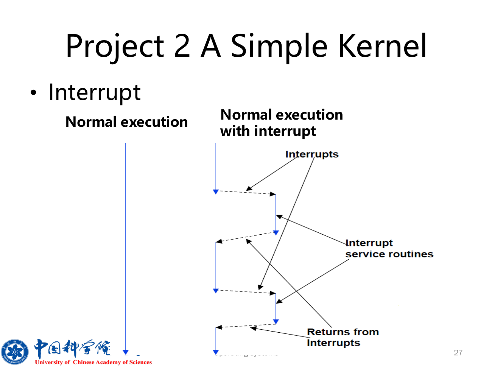

### 📄 原文翻译

> **Project 2 – 一个简易内核**
> • **中断**

图中左右对比：

```
   正常执行                    带中断的正常执行

      │                     ──→┐         ┌──── Interrupts（中断）
      │                        ↓         ↑        （中断到来）
      │                     ┌──┴─────────┴──┐
      │                     │  ← 处理中      │
      │                     └──┬─────────┬──┘
      │                        ↓         ↑   Interrupt service routines
      │                     ┌──┴─────────┴──┐   （中断服务例程）
      │                        ↓         ↑
      │                     ┌──┴─────────┴──┐
      ↓                        ↓              Returns from Interrupts
   （时间）                  （时间）           （从中断返回）
```

### 💡 讲解

**这张图讲的是"中断透明性"**：左边是程序一路执行下去；右边是同样的程序，但中间被**多次**打断，每次跑去执行一段"中断服务例程"，执行完再**回到原来被打断的地方继续**。

⚠️ **关键观察**：右图的蓝色主线**依然是连续的**——中断只是插进来又出去，程序本身的执行顺序**没有改变**。这就是"恢复现场"的意义：**让被打断的程序完全感知不到中断发生过**。

📌 这张图也解释了为什么中断**可以嵌套理解成多层进出**：每次中断都"进去→处理→出来"。

⚠️ 但注意一个细节：RISC-V 硬件在进入例外时会**自动关闭中断**（`sstatus.SIE = 0`），所以默认情况下**中断不会嵌套**。这个机制在 P36 会正式讲。

---

## P28


### 📄 原文翻译

> **Project 2 – 一个简易内核**
> • **硬件中断**
> 　– 由**硬件事件**引起的执行流改变
> 　　• 用于**分时**的定时器中断
> 　　• I/O 设备中断：磁盘、网络、键盘等
> 　– **我们这里不处理**其他中断
> 　　• 缺页（Page fault）、TLB 缺失等
> • **陷阱（Trap）**
> 　– 系统调用

### 💡 讲解

**这一页在做"分类学"，划定了本课程的边界。**

RISC-V 把**中断（interrupt）**和**异常（exception）**统称为**例外（trap）**。任务书 5 节的定义：

> "在 RISC-V 中，将中断 (interrupt) 和异常 (exception) 统称为例外 (trap)。通俗点说，它是程序在正常执行过程中的**强制转移**。产生例外的原因有很多：有一些例外是**主动触发**的，比如系统调用 `syscall`；有一些例外是**被动触发**的，比如硬件异常。"

分类图：

```
例外 (trap)
 ├─ 中断 (interrupt)     ── 异步，来自硬件/外部
 │   ├─ 定时器中断        ← 本课程要处理（任务 4）
 │   ├─ I/O 设备中断（磁盘/网络/键盘）← 本课程不处理
 │   └─ 软件中断
 └─ 异常 (exception)     ── 同步，由指令本身引起
     ├─ 缺页错误 (page fault)   ← 本课程暂不处理（P4 才讲虚存）
     ├─ 非法指令 / 地址不对齐等  ← 本课程不主动处理（S-core 只打印）
     └─ 环境调用 (ecall)        ← 本课程要处理（任务 3，即系统调用）
```

**本课程的取舍**：
- ✅ **定时器中断**（任务 4）：抢占式调度的动力来源
- ✅ **环境调用 `Environment call`**（任务 3）：系统调用
- ❌ 其他一律不管。**但**——任务书任务 3S 提醒：*"不能排除仍然会有没考虑到的各种软、硬件的例外发生，如果不进行例外处理，操作系统一般会直接'跑飞'了。"* S-core 也要做一个兜底的"打印报错"处理。

---

## P29

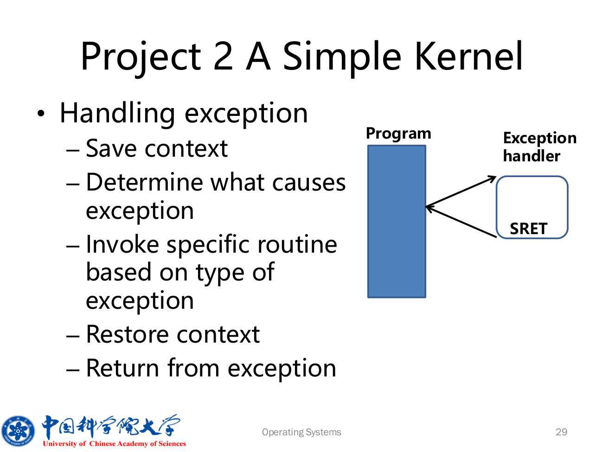

### 📄 原文翻译

> **Project 2 – 一个简易内核**
> • **处理例外**
> 　– 保存现场
> 　– 判断是什么引起了例外
> 　– 根据例外的类型，调用对应的处理例程
> 　– 恢复现场
> 　– 从例外返回

右侧示意图：**程序 (Program)** ⇄ **例外处理程序 (Exception handler)**，返回时用 **`SRET`** 指令。

### 💡 讲解

**★ 这是整个下半场的骨架 ★**——五步流程，后面的 P30–P39 全是在展开这五步的细节。

| 步骤 | 对应机制 | 对应课件页 |
|---|---|---|
| ① 保存现场 | `SAVE_CONTEXT` 宏，存进 `regs_context_t` | P13、P37 |
| ② 判断原因 | 读 `scause` 寄存器 | P38 |
| ③ 调用对应处理例程 | `exc_table` / `irq_table` 分发 | P37 |
| ④ 恢复现场 | `RESTORE_CONTEXT` 宏 | P39 |
| ⑤ 从例外返回 | `sret` 指令，跳到 `sepc` | P39 |

⚠️ **注意步骤 ①②③ 是"硬件自动 + 软件配合"的分工**：
- **进**：硬件自动把 PC 存 `sepc`、跳到 `stvec`——**这一步你不用写代码**
- **然后**：你的汇编代码接住，保存寄存器，再调 C 函数按 `scause` 分发
- **出**：恢复寄存器，执行 `sret`，硬件自动跳回 `sepc` 并恢复中断使能

📌 **任务书里"三级处理"的说法**（5.2 节）：
- **第一级**：硬件跳进 `stvec` 指向的地址——**硬件做，不用你实现**
- **第二级**：根据 `scause` 判断类型，跳到对应的处理函数——**你要实现**
- **第三级**：具体的处理函数（定时器中断处理、系统调用处理）——**你要实现**

---

## P30


### 📄 原文翻译

> **Project 2 – 一个简易内核**
> • **控制状态寄存器（CSR）**
> 　– 在实现中断处理程序时，我们需要操作 CSR
> 　– CSR 有两类
> 　　– 一类用于**设置**中断
> 　　– 另一类用于**处理**中断
> 　– 请参考任务书中的表 P2-2

### 💡 讲解

**为什么需要 CSR？** 因为中断相关的控制信息（中断使能、例外入口地址、例外原因、例外返回地址）不能放在普通寄存器里——它们必须**在特权级切换时保持稳定**，而且**不能被用户程序随意篡改**。所以 RISC-V 专门划了一类寄存器来做这件事。

**两类 CSR 的划分**（这个划分帮你理清任务 4 的步骤）：

| 类别 | 寄存器 | 用途 |
|---|---|---|
| **设置中断**（初始化时用一次） | `sie`、`stvec`、`sstatus` | 告诉硬件"哪些中断可以来"、"例外入口在哪"、"中断全局开关" |
| **处理中断**（每次中断都用） | `scause`、`sepc`、`stval`、`sscratch` | "为什么进来"、"刚才执行到哪"、"出错的地址是什么"、"临时存放现场" |

📌 **RISC-V 特权级回顾**（任务书 5.1）：三个层级
- **Machine (M)**：最底层，BIOS 用
- **Supervisor (S)**：**操作系统跑在这一级**
- **User (U)**：用户程序跑在这一级

⚠️ 有意思的一点：**定时器相关的寄存器都在 M 级**，S 级（也就是你的内核）**不能直接控制**，必须通过 `set_timer` 这个 BIOS/SBI 调用间接设置。这是为什么任务 4 里要用 `bios_set_timer`。

---

## P31

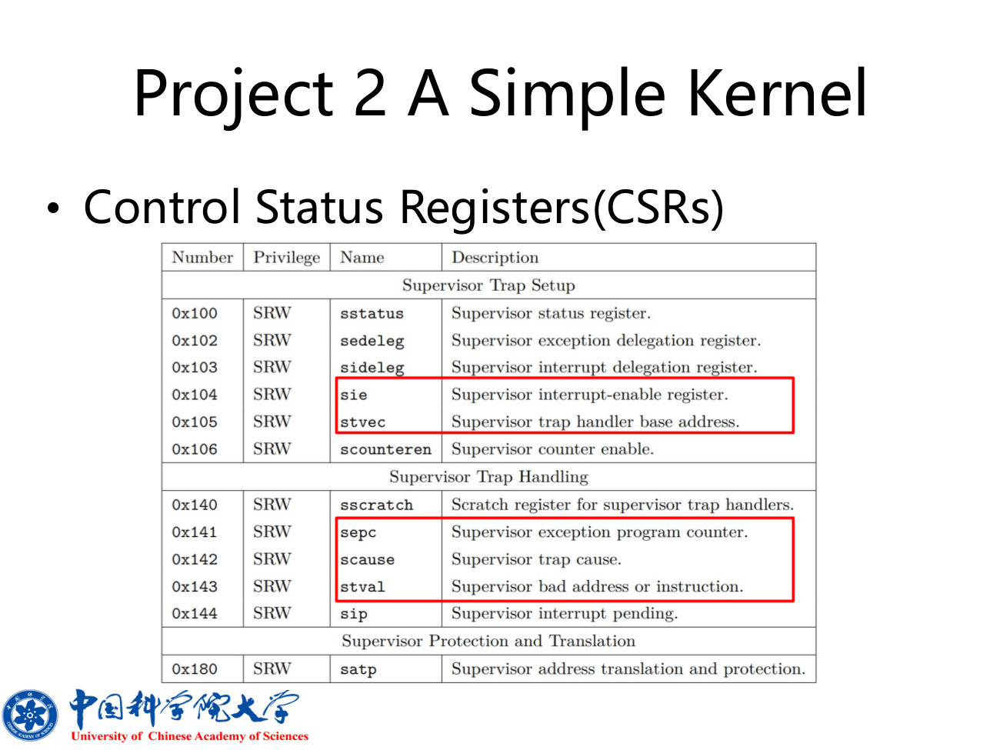

### 📄 原文翻译

> **Project 2 – 一个简易内核**
> • **控制状态寄存器（CSR）**

（图为 Supervisor 级 CSR 地址表，其中**红框标出 5 个重点寄存器**）

| 编号 | 名称 | 描述 | 课件是否红框 |
|---|---|---|---|
| 0x100 | `sstatus` | Supervisor 状态寄存器 | |
| 0x102 | `sedeleg` | 例外委托寄存器 | |
| 0x103 | `sideleg` | 中断委托寄存器 | |
| 0x104 | **`sie`** | **Supervisor 中断使能寄存器** | ✅ |
| 0x105 | **`stvec`** | **Supervisor 例外处理入口基址** | ✅ |
| 0x106 | `scounteren` | 计数器使能 | |
| 0x140 | `sscratch` | 例外处理程序的暂存寄存器 | |
| 0x141 | **`sepc`** | **Supervisor 例外程序计数器** | ✅ |
| 0x142 | **`scause`** | **Supervisor 例外原因** | ✅ |
| 0x143 | **`stval`** | **Supervisor 出错地址/指令** | ✅ |
| 0x144 | `sip` | Supervisor 中断挂起 | |
| 0x180 | `satp` | 地址翻译与保护（虚存，P4 用） | |

### 💡 讲解

**红框的 5 个就是本 Project 要打交道的全部 CSR。**

按"设置 / 处理"归类：

**设置类（任务 3、4 初始化时写一次）**
- **`stvec`**：例外处理入口地址。发生任何例外，硬件自动跳到这里
- **`sie`**：中断使能位图。逐位控制"哪一类中断允许发生"
- （`sstatus` 的 `SIE` 位：中断**总开关**）

**处理类（每次例外都要读写）**
- **`scause`**：**为什么**进来的——是定时器中断？还是 `ecall`？
- **`sepc`**：例外发生时**执行到哪条指令**——将来 `sret` 要跳回来
- **`stval`**：**出错的地址或指令**——调试时最有用

⚠️ **一个容易被忽略但很关键的区别**（任务书 5.2 专门提醒）：
> "注意区分 `sie` 寄存器和 `sstatus` 寄存器中的 `SIE` 位的区别。"

- `sie`（小写，这是个**寄存器名**）：**逐类**控制——"定时器中断允许吗？外部中断允许吗？"
- `sstatus.SIE`（大写的 SIE 是**寄存器里的一个位**）：**全局**总开关——"所有中断，统统允许/禁止"

**打个比方**：`sie` 是每个房间的电闸，`sstatus.SIE` 是总闸。房间电闸开着但总闸关了，灯还是不会亮。

📌 **`sscratch` 的妙用**（任务书任务 3 注意事项 5）：
> "在例外发生之后、处理之前，我们需要保存通用寄存器现场至某处。保存的操作可能需要一个通用寄存器来辅助，请了解 `sscratch` 寄存器会对这件事产生什么帮助。"

思考：进例外时你要保存 `a0`，但**保存 `a0` 需要先用一个寄存器**——用哪个？那个寄存器原来的值又存哪？这是个"先有鸡还是先有蛋"的问题。`sscratch` 就是这个问题的答案（进去时交换一下，出来时再换回来）。

---

## P32

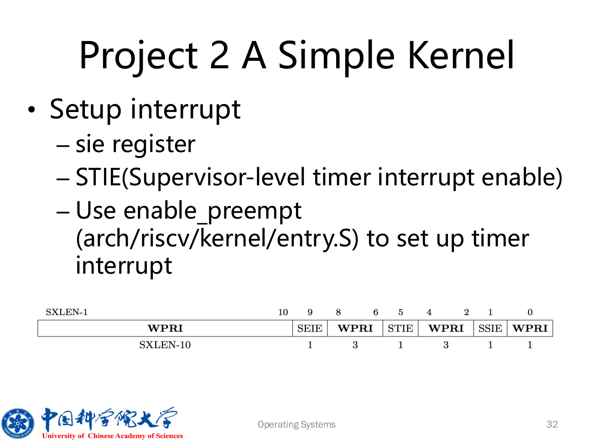

### 📄 原文翻译

> **Project 2 – 一个简易内核**
> • **设置中断**
> 　– `sie` 寄存器
> 　– `STIE`（Supervisor 级定时器中断使能）
> 　– 使用 `enable_preempt`（`arch/riscv/kernel/entry.S`）来设置定时器中断

（图为 `sie` 寄存器位图，红框标出 `STIE` 位）

```
 SXLEN-1        10   9    8    6   5    4    2   1    0
 ┌───────────────┬────┬────┬────┬────┬────┬────┬────┬────┐
 │      WPRI     │SEIE│WPRI│STIE│WPRI│SSIE│WPRI│…  │WPRI│
 └───────────────┴────┴────┴────┴────┴────┴────┴────┴────┘
       SXLEN-10      1    3    1    3    1    3    1
```

| 位 | 名称 | 含义 |
|---|---|---|
| 1 | **SSIE** | Supervisor 软件中断使能 |
| 5 | **STIE** | **Supervisor 定时器中断使能** ← 本任务要打开 |
| 9 | **SEIE** | Supervisor 外部中断使能 |

（`WPRI` = 保留位，写入无效；图中数值表示该字段占几位）

### 💡 讲解

**任务 4 的第一件事：打开定时器中断使能。**

要让定时器中断能进来，需要**同时**满足两个条件：

1. **`sie.STIE = 1`** —— 允许"定时器中断"这一**类**
2. **`sstatus.SIE = 1`** —— 打开中断**总开关**

任何一个为 0，定时器中断都进不来。这就是 P31 强调的区别的现实意义。

📌 **`enable_preempt` 函数**位于 `arch/riscv/kernel/entry.S`——**这是你自己要写的**（任务 4 步骤 1 说"完善 `trap.S` 中 `setup_exception` 代码，打开全局中断使能"）。

⚠️ **为什么叫 "enable_preempt"（启用抢占）？** 因为这个函数一执行，定时器中断就能进来了，从这一刻开始**内核具备抢占能力**。函数名本身就是设计意图的注解。

---

## P33

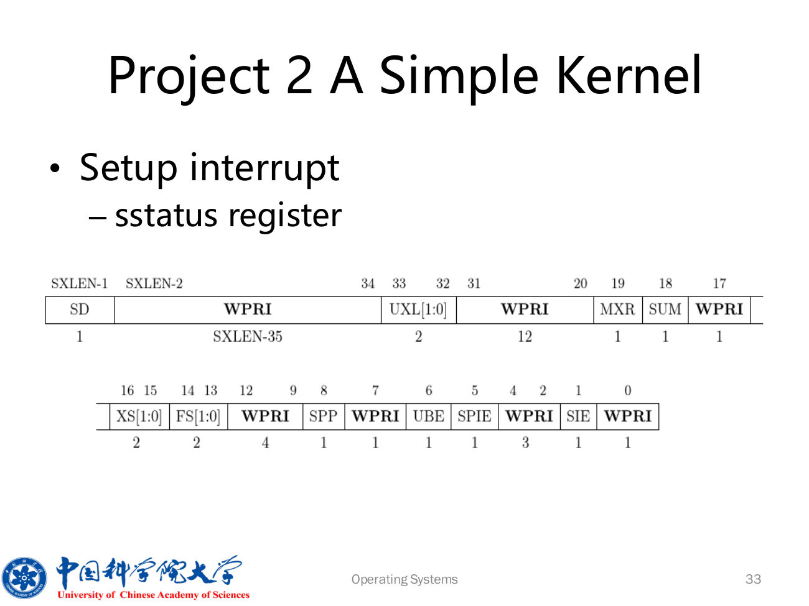

### 📄 原文翻译

> **Project 2 – 一个简易内核**
> • **设置中断**
> 　– `sstatus` 寄存器

（图为 RV64 的 `sstatus` 寄存器完整位图，重点在下半部分）

```
 16   15   14  13   12    9    8    7    6    5    4   2   1    0
 ┌────┬─────┬────┬────┬────┬────┬────┬────┬────┬────┬───┬────┐
 │XS  │ FS  │WPRI│ SPP│WPRI│ UBE│SPIE│WPRI│ SIE│WPRI│… │WPRI│
 │[1:0]│[1:0]│    │    │    │    │    │    │    │    │   │    │
 └────┴─────┴────┴────┴────┴────┴────┴────┴────┴────┴───┴────┘
    2     2     4     1    1    1    1    3    1    3   1
```

**本任务关心的三位**：

| 位 | 名称 | 含义 |
|---|---|---|
| 1 | **SIE** | Supervisor **中断总开关** |
| 5 | **SPIE** | Supervisor **先前的中断使能状态**（陷入前 SIE 是什么） |
| 8 | **SPP** | Supervisor **先前的特权级**（陷入前是 U 还是 S） |

（其余如 `SD`、`UXL`、`MXR`、`SUM`、`XS`、`FS`、`UBE` 本课程不涉及）

### 💡 讲解

`sstatus` 是**整个例外的中枢**，因为它同时承担"开关"和"记忆"两个职责。

**硬件在例外发生/返回时的自动行为，全围绕这三位**：

| 时刻 | 硬件自动做什么 |
|---|---|
| **进入例外时** | `SIE → 0`（关中断，防止中断套中断）；原来的 `SIE` 值 → `SPIE`（**记住**）；当前特权级 → `SPP`（**记住**）|
| **执行 `sret` 时** | `SPIE → 1`；`SIE ← 原来的 SPIE`（**恢复**）；特权级 ← `SPP`（**恢复**）|

⚠️ 这个"保存 — 恢复"的对称设计，正是 P26 里"中断透明性"的硬件保障。

📌 **一个重要推论**（任务书 5.2 结尾）：
> "我们并不需要自己手动重新打开中断。因为在还原现场时，`sstatus` 的值也会被还原。还原后，`sret` 指令会使得硬件自动把 `SIE` 设置为 `SPIE` 值。而 `SPIE` 值是中断发生前 `SIE` 的状态，此时应该是开启状态。所以 `SPIE` 后，`SIE` 位自然是开启状态。"

**不要在返回前手动 `csrs sstatus, SIE`**——硬件会做，你手动做反而可能搞乱。

---

## P34


### 📄 原文翻译

> **Project 2 – 一个简易内核**
> • **设置中断**
> 　– `SIE`（Supervisor Interrupt Enable）位：在 Supervisor 模式下**使能或禁止所有中断**
> 　– `SPIE`（Supervisor Previous Interrupt Enable）位：指示**在陷入 Supervisor 模式之前**，Supervisor 中断是否是被使能的
> 　– `SPP`（Supervisor Previous Privilege Mode）位：指示**陷入之前**的特权模式
> 　– 你需要在 `sstatus` 寄存器中**正确地初始化 `SPIE(1)`、`SPP(0)`**

### 💡 讲解

**这三位的文字定义，以及一个必须记住的具体答案。**

⚠️ **`SPIE(1), SPP(0)` 是什么意思？为什么是这两个值？**

这是 `init_pcb_stack` 里（P13 那个 `[p2-task3]` TODO）要填的初值：

```c
pt_regs->sstatus = ...;   // 需要置 SPIE=1, SPP=0
```

**为什么 `SPP = 0`？**
任务 3 之后，进程要运行在 **User 态**。`sstatus.SPP` 记录"陷入前的特权级"：
- `SPP = 0` → User 态
- `SPP = 1` → Supervisor 态

所以造新进程的"假现场"时，必须**假装它是从 User 态陷进来的**，这样 `sret` 才会把它**送进 User 态**执行。

⚠️ **这是任务 3 最容易出错的点之一**。任务书任务 3 注意事项 1 警告得极重：
> "RISC-V 在所有特权级下都用 `ecall` 执行系统调用。**Supervisor 态的 `ecall` 会触发 Machine 态的例外，User 态的 `ecall` 会触发 Supervisor 态的中断。所以大家务必注意，要让 User 模式的进程运行在 User 态。**"

**如果 `SPP` 设错成 1，进程会以 Supervisor 态运行** → 它执行 `ecall` 时不会掉进你的 Supervisor 例外处理程序，而是掉进 **Machine 态**（BBL 的地盘）→ 你的系统调用**完全不会被触发**，表现为"用户程序一动不动"。

**为什么 `SPIE = 1`？**
`SPIE` 是"陷入前的 SIE 值"。设成 1 表示"这个进程进入内核前，中断是开着的"。这样 `sret` 返回用户态时，硬件会把 `SIE` 恢复成 1——**中断重新打开，抢占式调度才能继续工作**。

**对比一下两个"假现场"的初始化**：

| | 任务 1/2 的假现场 | 任务 3 之后的假现场 |
|---|---|---|
| 存哪 | `switchto_context_t` | `regs_context_t` |
| 存什么 | `ra`、`sp`、callee-saved | **全部 32 个 GPR + `sstatus`、`sepc`、`sp`** |
| 为什么要 `sstatus` | 不需要（同特权级） | **必须**，因为要控制返回时的特权级和中断状态 |

---

## P35


### 📄 原文翻译

> **Project 2 – 一个简易内核**
> • **操作 CSR 寄存器**
> 　– `csrr`：读 CSR
> 　　• 把一个 CSR 寄存器里的数据加载到 CPU 通用寄存器中
> 　– `csrw`：写 CSR
> 　　• 把数据存入一个 CSR 寄存器
> 　– `csrc` / `csrs`：清除 / 设置一个 CSR 寄存器中对应的位
> 　• 例子
> 　　– `csrr a0, sip`
> 　　– `csrw stvec, t0`

### 💡 讲解

**四条（伪）指令，就是个"读写 + 位操作"的接口**：

| 指令 | 全称 | 作用 | 典型用法 |
|---|---|---|---|
| `csrr rd, csr` | CSR Read | 读 | `csrr a0, scause` —— 看看为什么进来 |
| `csrw csr, rs` | CSR Write | 整字写 | `csrw stvec, t0` —— 设置例外入口 |
| `csrs csr, rs` | CSR Set bits | 置位 | `csrs sie, t0` —— 打开某个中断使能位 |
| `csrc csr, rs` | CSR Clear bits | 清位 | `csrc sstatus, t0` —— 关掉某个开关 |

⚠️ **`csrs` / `csrc` 是"或/与非"语义**：它们**只改动 rs 里为 1 的那些位**，其他位保持不动。所以"打开 `STIE`"应该是：
```
li t0, (1 << 5)      # STIE 是第 5 位
csrs sie, t0         # 只把第 5 位置 1，其他不动
```
而不是 `csrw` 整个寄存器——那样会把其他使能位全冲掉。

📌 **底层真身**：`csrr` / `csrw` 是**伪指令**，`Zicsr` 扩展实际提供的是三条真指令：
- `csrrw`（read-write，写新的并返回旧的，**原子交换**）
- `csrrc`（read-clear）
- `csrrs`（read-set）

⚠️ **一个实际影响**：`csrrw` 会**无条件写**。所以如果要读一个**只读 CSR 且不想写**，得用 `csrrs rd, csr, x0`（x0 恒 0，相当于"置位 0 位"= 什么都不改）。`csrr` 伪指令展开成的就是这个。这个细节在 `sscratch` 交换时很重要。

📌 任务书 5.2 的 Note 5.2 还提到：框架在 `csr.h` 里定义了一些宏，**你可以不用宏，直接用 CSR 名字写汇编**。

---

## P36


### 📄 原文翻译

> **Project 2 – 一个简易内核**
> • **如果中断在处理中断程序的过程中发生，会怎样？**
> 　– 处理器在中断发生时**自动禁止所有中断**
> 　– 处理器在 `sret` 被调用后**自动重新启用所有中断**

### 💡 讲解

**这是 P27 那张图留下的伏笔的答案：为什么中断不会无限嵌套？**

答案：**硬件帮你把门关上了。**

```
进入例外那一刻：
   sstatus.SIE: 1 → 0     ← 硬件自动关中断
   sstatus.SPIE: ← 原来的 SIE

于是，你在处理例外的整段代码期间，新的中断进不来。
（这叫做"临界区保护"，而且是硬件免费提供的）

执行 sret 那一刻：
   sstatus.SIE ← SPIE     ← 硬件自动把中断恢复
   sstatus.SPIE → 1
```

⚠️ **这个机制带来两个重要推论**：

1. **例外处理程序天然是"原子"的**——在它执行期间不会有新中断插进来。所以你在里面改全局状态（就绪队列、`current_running`）是**安全的**，不用担心被打断。（任务书 3.3 节讲"单内核栈的缺点是陷入内核的这部分代码必须被划为临界区、被原子执行完"，而多内核栈没有这个限制——**但**这是指"不想被抢占"的场景；硬件默认还是先关门。）

2. **不要在例外处理里长期关闭中断**——如果你想在某些临界区里额外保护，可以用 `csrc sstatus, SIE` 手动关，但**必须记得打开**。忘了开 → 系统再也不响应定时器 → 屏幕上一切静止。

⚠️ **但要注意**：如果**确实需要**中断嵌套（比如处理一个耗时很长的中断时还希望响应定时器），就得在处理程序里**手动重新打开中断**。本课程**不需要**这么做——这也解释了为什么任务书说"我们并不需要自己手动重新打开中断"。

---

## P37

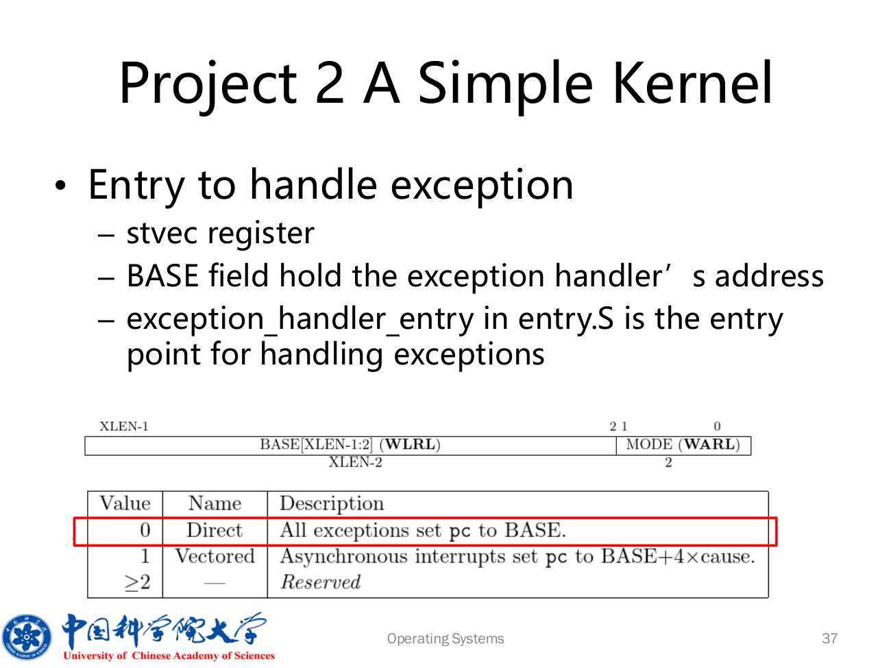

### 📄 原文翻译

> **Project 2 – 一个简易内核**
> • **处理例外的入口**
> 　– `stvec` 寄存器
> 　– **BASE 字段保存例外处理程序的地址**
> 　– `entry.S` 里的 `exception_handler_entry` 就是处理例外的入口点

**下方两张图**：

`stvec` 寄存器结构：
```
 XLEN-1                                     2 1        0
 ┌─────────────────────────────────────────┬──────────┐
 │        BASE[XLEN-1:2]  (WARL)           │ MODE     │
 │                                         │ (WARL)   │
 └─────────────────────────────────────────┴──────────┘
                  XLEN-2                          2
```

MODE 取值表：

| 值 | 名称 | 描述 | 课件红框 |
|---|---|---|---|
| **0** | **Direct（直接）** | **所有例外都把 pc 设为 BASE** | ✅ |
| 1 | Vectored（向量） | 异步中断把 pc 设为 `BASE + 4×cause` | |
| ≥2 | — | 保留 | |

### 💡 讲解

**`stvec` 就是"例外的总入口"**——所有例外（定时器中断、系统调用、出错）发生时，硬件**无条件**把 PC 跳到 `stvec.BASE` 指向的地址。这个地址就是你要写的 `exception_handler_entry`。

**两种 MODE 的区别，是本页的核心**：

| | Direct 模式 | Vectored 模式 |
|---|---|---|
| 硬件行为 | 一律跳到 `BASE` | 跳到 `BASE + 4×cause` |
| 谁来分发 | **你的代码**（看 `scause` 再分支） | **硬件**（用 cause 当偏移量查表） |
| 类比 | 所有信件都送传达室，再人工分拣 | 每栋楼有专门的收件口，按门牌号直接送 |
| 本课程 | ✅ **采用这个** | |

**为什么 BASE 的低 2 位是 0？**
RISC-V 指令是 **4 字节对齐**的，所以任何指令地址的低 2 位必然是 0。既然永远用不到，硬件就把这 2 位**挪作他用**——存放 MODE。

⚠️ **这意味着一个陷阱**：写 `stvec` 时**不能直接把函数地址写进去**——如果 MODE 位不为 0，地址的解释方式就变了。标准做法是：
```asm
la t0, exception_handler_entry
csrw stvec, t0            # 地址低 2 位天然是 0，即 MODE=Direct
```
或者显式地 `andi` 清低位保证 MODE=0。

📌 **本课程的取舍**（任务书 5.2）：
> "本实验的 start code 是按照 **Direct** 模式设计的，建议大家使用 Direct 模式。"

📌 **三级处理流程**（任务书 5.2 的"第一级/第二级/第三级"）：
- **第一级**：硬件跳到 `stvec` ← **硬件自动，不用你写**
- **第二级**：你的代码读 `scause`，判断类型，跳到对应处理函数 ← **要你写**（`exception_handler_entry` + `irq.c` 的 `exc_table` / `irq_table`）
- **第三级**：具体的处理函数本身 ← **要你写**（`handle_irq_timer`、`handle_syscall`）

---

## P38

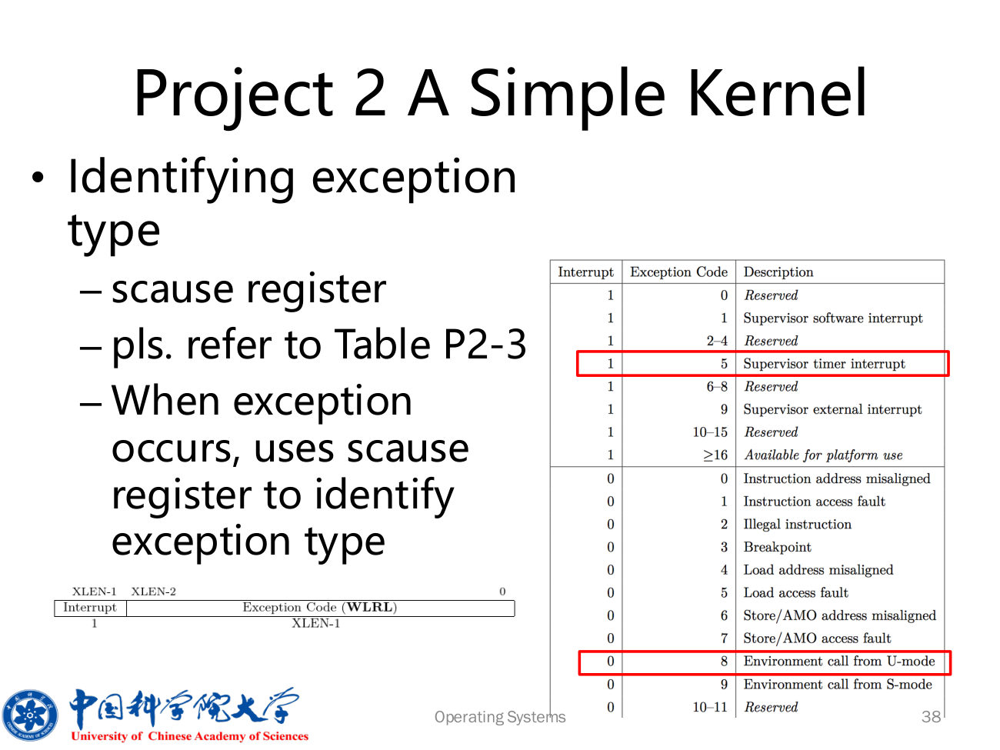

### 📄 原文翻译

> **Project 2 – 一个简易内核**
> • **识别例外的类型**
> 　– `scause` 寄存器
> 　– 请参考表 P2-3
> 　– 当例外发生时，用 `scause` 寄存器来识别例外的类型

**`scause` 寄存器结构**：
```
 XLEN-1  XLEN-2                                    0
 ┌──────┬───────────────────────────────────────────┐
 │Interr│        Exception Code (WLRL)              │
 │ upt  │                                           │
 └──────┴───────────────────────────────────────────┘
    1                    XLEN-1
```

**取值表（Supervisor 例外原因）**：

| Interrupt | Exception Code | 描述 | 课件红框 |
|---|---|---|---|
| 1 | 0 | 保留 | |
| 1 | 1 | Supervisor 软件中断 | |
| 1 | 2–4 | 保留 | |
| **1** | **5** | **Supervisor 定时器中断** | ✅ |
| 1 | 6–8 | 保留 | |
| 1 | 9 | Supervisor 外部中断 | |
| 1 | 10–15 | 保留 | |
| 1 | ≥16 | 平台可用 | |
| 0 | 0 | 指令地址不对齐 | |
| 0 | 1 | 指令访问错误 | |
| 0 | 2 | 非法指令 | |
| 0 | 3 | 断点 | |
| 0 | 4 | 加载地址不对齐 | |
| 0 | 5 | 加载访问错误 | |
| 0 | 6 | 存储/AMO 地址不对齐 | |
| 0 | 7 | 存储/AMO 访问错误 | |
| **0** | **8** | **来自 U 态的环境调用（即系统调用）** | ✅ |
| 0 | 9 | 来自 S 态的环境调用 | |
| 0 | 10–11 | 保留 | |
| 0 | 12 | 指令缺页 | |
| 0 | 13 | 加载缺页 | |
| 0 | 14 | 保留 | |
| 0 | 15 | 存储/AMO 缺页 | |
| 0 | 16–23 | 保留 | |
| 0 | 24–31 | 自定义可用 | |
| 0 | 32–63 | 保留/自定义 | |
| 0 | ≥64 | 保留 | |

### 💡 讲解

**★ 这张表是任务 3、4 的"字典"，两个红框就是本课程要处理的两个例外。**

⚠️ **先看最高位 `Interrupt`（中断位）——这是最重要的分类键**：

| `Interrupt` | 含义 | 性质 |
|---|---|---|
| **1** | **中断**（interrupt） | **异步**——外部硬件触发，和当前执行的指令无关 |
| **0** | **异常**（exception） | **同步**——由当前这条指令直接引起 |

所以判断逻辑是：
```c
if (scause & (1UL << 63))          // 最高位为 1 → 中断
    → 查 irq_table[scause & 0xF]   // 去掉最高位得到 cause
else                                // 最高位为 0 → 异常
    → 查 exc_table[scause]
```

**两个红框**：

| 编码 | 名称 | 对应任务 | 触发方式 |
|---|---|---|---|
| `Interrupt=1, Code=5` | **Supervisor 定时器中断** | **任务 4** | 定时器到期，硬件**异步**触发 |
| `Interrupt=0, Code=8` | **来自 U 态的环境调用** | **任务 3** | 用户程序执行 `ecall` 指令，**同步**触发 |

📌 **`0 / 8` 为什么是 "from U-mode" 而不是 "from S-mode"？**

因为 P34 讲的 `sstatus.SPP = 0` —— 用户进程必须真的跑在 **User 态**，它执行的 `ecall` 才会产生 `code=8`。
如果错误地让进程跑在 S 态，`ecall` 会产生 `code=9`（Environment call from S-mode）——**而 S 态的 `ecall` 会触发 Machine 态例外**，跑到 BBL 那边去了，你的处理程序根本接不到。这就是任务书任务 3 注意事项 1 警告的坑。

⚠️ **`stval` 在两种例外下的含义不同**（任务书 5.3 / P31 讲过）：
- 对**同步异常**（如缺页、访问错误）：`stval` = **出错的地址或指令**
- 对**中断**：`stval` 通常为 0 或无意义

S-core 的任务 3S 要求打印"发生例外的指令地址以及出错的地址"——前者来自 `sepc`，后者来自 `stval`。任务书特别注明：*"这两者不一定相等，因为有些例外是因为指令本身出错导致的，有些例外是指令里调用的地址出错导致的。"*

---

## P39


### 📄 原文翻译

> **Project 2 – 一个简易内核**
> • **从例外返回**
> 　– `sepc` 寄存器
> 　– 例外发生时，PC 的地址被存进 `sepc`
> 　– `sret` 可以返回到 `sepc` 中的地址
> 　– **处理系统调用时请注意 `sepc` 的地址**
> 　　• **`sret` 应当返回到 `sepc + 4`**

### 💡 讲解

**⚠️ `sepc + 4` 是任务 3 里最经典的一个坑，也是必问点。**

**问题的由来**：`ecall` 指令触发例外时，硬件把 **`ecall` 这条指令自己的地址**（不是下一条）存进 `sepc`。

如果 `sret` 直接跳回 `sepc`，就会**重新执行一遍 `ecall`** → 又一次系统调用 → 又跳回 `sepc` → …… **死循环，系统卡死在同一个系统调用上**。

**解法**：处理系统调用时，**手动把 `sepc` 加 4**（RISC-V 指令定长 4 字节），跳过 `ecall`：

```c
// 在 handle_syscall 里
pcb->sepc += 4;    // 或者写回 CSR
// 之后 sret 就会返回到 ecall 的下一条指令
```

📌 任务书 5.2 结尾的原话：
> "对于系统调用来说，需要大家返回 `sepc+4` 的地址位置。这是因为，`sepc` 寄存器默认指向的是触发系统调用的 `ecall` 指令，如果还返回到这个 `ecall` 的地址，就又会触发一遍系统调用，就没完没了了。"

⚠️ **为什么定时器中断不需要 +4？**
因为定时器中断是**异步**的——它不对应某条特定指令。`sepc` 存的是"被打断时正在执行的那条指令"，那条指令**还没执行完**。所以 `sret` 应该跳回 `sepc` **原地址，重新执行它**，程序才能正确地从中断点继续。**加 4 反而会跳过一条指令，程序行为就错了。**

**小结这张表**（很值得记）：

| 例外类型 | `sepc` 指向 | `sret` 应返回到 | 为什么 |
|---|---|---|---|
| **系统调用**（`ecall`） | `ecall` 指令本身 | **`sepc + 4`** | 指令已"完成"，要跳到下一条 |
| **定时器中断** | 被打断的指令 | **`sepc`** | 指令还没执行完，要重新执行 |

---

## P40


### 📄 原文翻译

> **Project 2 – 一个简易内核**
> • **支持进程睡眠**
> 　– **阻塞式睡眠**
> 　　• 当任务调用 `sleep()` 时把它阻塞住
> 　　• 用一个**单独的队列**来保存睡眠中的任务
> 　– **唤醒任务**
> 　　• 当时间达到这个任务的睡眠阈值时
> 　– **关于计时**
> 　　• 我们在 `time.c` 里提供了计时相关的函数
> 　　• 用这些函数来判断睡眠是否结束

### 💡 讲解

**`sleep` 是"定时 BLOCK"**——和等锁的 BLOCK 机制完全一样，只是唤醒条件从"锁被释放"变成了"时间到了"。

**设计要点**：

| 要素 | 做法 |
|---|---|
| 存放地点 | **单独的睡眠队列**（`sleep_queue`），不是就绪队列 |
| 每个进程记什么 | `wakeup_time`（PCB 里的字段，见 P7）——**它该醒来的时刻** |
| 怎么判断该醒了 | 拿当前时间跟 `wakeup_time` 比 |
| 时间从哪来 | `time.c` 里的计时函数（如 `get_timer`，用 `bios_read_fdt` 读到的 CPU 频率换算）|

⚠️ **为什么必须单独一个队列？**
如果睡着的进程留在就绪队列里，调度器会把它选上来跑——但它还不想醒，于是又睡回去，白白浪费一次调度。所以**睡觉的进程必须从就绪队列里摘出去**，这是 P19/P20 反复强调的同一条原则。

📌 **顺带提一个对比**（呼应 P20 的"等待队列"）：

| BLOCK 原因 | 挂在哪个队列 | 谁负责唤醒 |
|---|---|---|
| 等锁 | **锁的**等待队列 | 释放锁的进程（`do_mutex_lock_release` 里调 `do_unblock`）|
| `sleep()` | **全局**睡眠队列 | 调度器（每次调度时检查时间）|

---

## P41


### 📄 原文翻译

> **Project 2 – 一个简易内核**
> • **实现定时器中断处理程序**
> 　– **处理普通任务**
> 　　• 按照你的调度策略进行调度
> 　　• 轮转（Round Robin）策略就可以
> 　– **处理睡眠中的任务**
> 　　• 检查是否要唤醒该任务
> 　– 用 `bios_set_timer` 重置定时器（`include/os/bios.h`）
> 　– CPU 频率通过 `main.c` 里的 `bios_read_fdt` 获得

### 💡 讲解

**★ 这是任务 4 的核心：定时器中断处理程序 `handle_irq_timer` 要做三件事 ★**

```
handle_irq_timer():
  ① 重新设置定时器      bios_set_timer(下次触发时刻)
                        ↑ 必须在最前面！否则定时器不再触发，抢占式就死了
  ② 处理睡眠中的任务    检查 sleep_queue，把到期的唤醒 → 放回就绪队列
  ③ 触发调度            do_scheduler() → 轮转，换下一个进程
```

⚠️ **①为什么至关重要？**
RISC-V 的定时器是**一次性**的——触发一次后就不管了。如果你不在处理程序里重新"上弦"，**定时器中断只会发生一次**，之后系统就退化成非抢占式了。症状：屏幕上的飞机飞一小段就卡住不动。

⚠️ **②和③的顺序有讲究**：要先唤醒到期的进程（让它们回到就绪队列），**再**调度——这样刚醒的进程**这一轮就有机会被选中**。反过来做的话，它们得白等一整轮。

⚠️ **定时器寄存器的位置**（任务书 5.7）：
> "定时器相关的寄存器都在 Machine 级，Supervisor 级无法直接控制相关的寄存器，需要使用 `set_timer` 设置定时器的触发，设置的内容为**下次触发定时器中断的时钟数**。因此，设置之前需要**读取当前时间，计算下次定时器中断的时间后再设置进去**。"

所以典型写法是：
```c
uint64_t current = get_timer();              // 读当前时间
set_timer(current + TIME_INTERVAL);          // 设置下次触发（当前 + 间隔）
```
`TIME_INTERVAL` **就是你的时间片长度**——它直接决定了每个进程一次能跑多久。这也是任务 5 里"动态调整时间片"要改动的量。

📌 **`bios_read_fdt`（`main.c` 里调用）**：通过扁平设备树（Flattened Device Tree）读取 **CPU 频率**，用它把"时钟数"换算成真实的秒/毫秒。任务书任务 3 注意事项 3 提到了这个：*"`main.c` 的开头会调用 `read_fdt` 函数读取 CPU 频率，请大家参考 `kernel/sched/time.c` 文件，使用 `get_timer` 函数获取当前 CPU 时间。"*

---

## P42


### 📄 原文翻译

> **Project 2 – 一个简易内核**
> • **循序渐进 – 任务 3**
> 　– 实现系统调用
> 　– 支持 `do_sleep`
> 　– **在这个任务中，我们还没有定时器中断**，你需要考虑什么时候检查睡眠时间

### 💡 讲解

**⚠️ 最后那句是任务 3 最尖锐的设计问题，也是最容易被问倒的地方。**

**问题的张力**：
- `sleep` 需要"**定时**检查时间是否到了"
- 但"定时"最自然的工具——**定时器中断**——**在任务 3 里还没有**（那是任务 4 才做的）

**那任务 3 怎么办？**

推论是：任务 3 里唯一能检查睡眠时间的地方，就是**每次有人调用 `do_scheduler` 的时候**。也就是说，`do_scheduler` 开头那个 `[p2-task3] Check sleep queue to wake up PCBs`（P11 的代码）**就是答案的落点**：

```
任务 3 里：
  睡眠进程只能等"下一次调度发生"时才有机会被唤醒
  而"调度发生"靠的是进程主动 sys_yield
  → 所以：如果所有进程都在 sleep，没人 yield，系统就卡住了！

任务 4 里：
  定时器中断周期性地强制调用 do_scheduler
  → 睡眠进程每次时钟中断都有机会被检查
  → 即使所有进程都在睡，定时器也会把它们叫醒
```

📌 **这正是 P46 里那问"任务 3 和任务 4 中，分别何时唤醒睡眠的进程？"的标准答案。**

⚠️ **换句话说，任务 3 的 `sleep` 是"不完整"的**——它依赖进程主动让出 CPU 才能工作。这是一个**故意设计的教学递进**：先让你体会"没有中断有多难受"，再用任务 4 的定时器中断把它修好。

---

## P43


### 📄 原文翻译

> **Project 2 – 一个简易内核**
> • **循序渐进 – 任务 4**
> 　– 实现定时器中断处理程序
> 　– 实现轮转调度器

### 💡 讲解

任务 4 的验收标准（任务书 5.8）：

> "运行给定的所有测试程序（syscall 版本），要求**注释掉其中所有的 `sys_yield`**，要求打印出和任务 3 一样的正确结果。"

⚠️ **"注释掉所有 `sys_yield`"是任务 4 的核心考点**：这是在证明你的抢占**真的在起作用**。如果还留着 `sys_yield`，程序照样能跑对——但那是进程自己在让出，不是操作系统在抢占。**去掉它，功能不变，才说明内核真的具备了抢占能力。**

📌 **任务 4 要做的五件事**（任务书步骤）：
1. 完善 `trap.S` 的 `setup_exception`——**打开全局中断使能**（`sstatus.SIE = 1`）
2. 完善 `irq.c` 的 `init_exception`——初始化**中断入口表** `irq_table`
3. 完成 `irq.c` 的 `handle_irq_timer`——重设 timer + 重新调度
4. `main.c` 里初始化定时器中断；把 `while(1)` 里的 `do_scheduler` 注释掉，换成 `enable_preempt`
5. 跑测试程序，**注释掉所有 `sys_yield`**，结果要和任务 3 一致

⚠️ **任务书专门提醒的一个思维转变**（任务 4 注意事项 1）：
> "关于如何正确地开始一个任务的第一次调度，在**抢占调度模式下**是和非抢占调度模式下**不同**的，希望大家仔细思考如何在抢占调度模式下对一个任务发起第一次调度。"

**区别在哪？** 非抢占式下，`main` 主动调 `do_scheduler()` 就切过去了。抢占式下，`main` 调 `enable_preempt` 开启中断后，**得等第一次定时器中断到来**才会发生调度——所以"谁来发起第一次调度"这个问题的答案变了。可能需要在开启抢占后**主动让出一次**，或者是让定时器第一次到期时自然触发。**⚠️ 这是要去代码里确认的一个点。**

📌 **任务书里的"要点解读"很值得读**（这段是调试心法）：
> "中断可能会带来各种各样的混乱。当你发现有一些离奇的错误的时候，可以考虑是否是**自己的栈出了问题**。栈指针一旦设置错误或者保存恢复得不正确，很有可能带来难以调试的错误。所以当有时候搞不清楚错在哪里时，可以考虑一下是不是**栈寄存器**设置错了。"

---

## P44

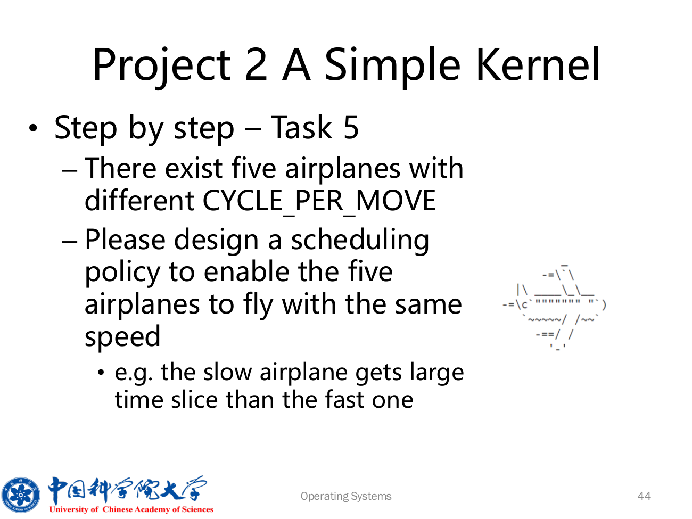

### 📄 原文翻译

> **Project 2 – 一个简易内核**
> • **循序渐进 – 任务 5**
> 　– 存在**五架飞机**，它们的 `CYCLE_PER_MOVE` 各不相同
> 　– 请设计一个调度策略，使得五架飞机**以相同的速度飞行**
> 　　• 例如：**慢的飞机获得比快的飞机更大的时间片**

（右侧是一架 ASCII 艺术小飞机）

### 💡 讲解

**这是 C-Core 的专属任务，也是最"有趣"的一个。**

**问题设置**：5 个 `fly` 程序，每个的 `CYCLE_PER_MOVE` 不同——意思是"每移动一格需要花多少个 CPU 周期"。有的飞机是"快飞机"（移动一格很省时间），有的是"慢飞机"。

**矛盾**：如果操作系统用**公平**的调度算法（每个进程给一样多的时间），那么：

```
快飞机：时间片内移动 10 格
慢飞机：时间片内移动 2 格
→ 五架飞机越飞越散，快的跑没影，慢的还在原地
```

**要求**：通过调度算法，让它们**看起来飞得一样快**。

**关键约束（这是题目的精髓）**：

> "由于操作系统**不知道**每个 fly 程序的飞行速度 `CYCLE_PER_MOVE`，所以只能根据**每次报告的位置**进行动态调整。"

⚠️ 也就是说，**内核不能作弊**——它不能去读用户程序里的 `CYCLE_PER_MOVE` 常量。它只能：
1. 用户程序通过系统调用 `set_sche_workload` **主动报告当前位置**（这个系统调用要你自己实现）
2. 内核根据"上次报告的位置"和"这次报告的位置"，**推算出**这架飞机的速度
3. 据此调整优先级 / 时间片

**期望的效果**：

| 飞机 | 时间片 | 结果 |
|---|---|---|
| 慢飞机 | **大** | 一次能多飞几格 |
| 快飞机 | **小** | 少飞几格，等等别人 |

⚠️ **两个"要点解读"（任务的隐藏考点）**：

1. **不能只看速度，还要看起点**：
> "且每个进程的**起始位置不同**，所以调度算法还要考虑飞机的**初始位置**，算出飞行速度。"

因为速度是"位置差 / 时间差"算出来的——如果初始位置不同但你没考虑，会误判速度。

2. **不能有进程分到 0 时间片**：
> "在呈现效果上，应该保证**视觉上每个飞机都处于飞行状态**，不能出现：飞机飞一段距离停下，等待其他飞机飞完再飞的视觉效果。也就是说，在动态调整时间片大小的过程中，应**避免某个进程被分到的时间片为 0**，导致飞机停下的场面。"

⚠️ **检查方式**（一定要知道）：
> "在检查中，老师助教们**有可能会现场修改起始位置和飞行速度**，来检验同学们是否做到了正确的动态调整。"

**所以千万别硬编码！** 如果你的算法里写了"飞机 A 应该比飞机 B 慢 3 倍"这种假设，现场一改参数就废了。必须做成**真正动态自适应**的。

---

## P45

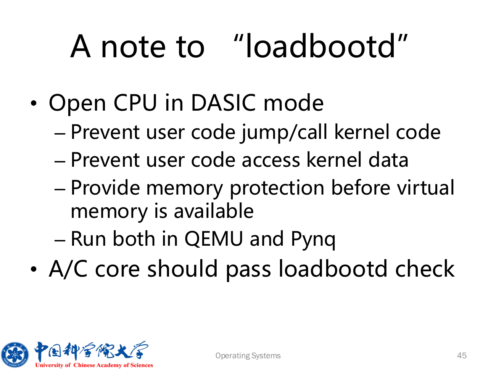

### 📄 原文翻译

> **关于 "loadbootd" 的说明**
> • 以 **DASIC 模式**打开 CPU
> 　– 阻止用户代码跳转/调用内核代码
> 　– 阻止用户代码访问内核数据
> 　– 在虚拟内存可用之前提供内存保护
> 　– 在 **QEMU 和 PYNQ 上都能运行**
> • **A/C-Core 应当通过 `loadbootd` 检查**

### 💡 讲解

**DASICS = 一个"没有虚存时的地址隔离方案"。**

**为什么需要它？**

任务 3 之后，用户程序跑在 **User 态**，内核跑在 **Supervisor 态**。看起来已经隔离了？**并没有。**

因为**虚存（Virtual Memory）还没启用**（那是 Project 4 的内容）。没有虚存，就没有页表，就**没有硬件级的地址保护**。用户程序虽然跑在 User 态，但它**仍然可以读写内核的内存地址**——只要它写出了那个地址。

> 任务书 6.2 节原文："如果同学们的代码有意无意的在 User 态访问了内核所在的内存地址空间的话，系统是**无法报错**的。这是因为我们现在还没有启用虚存，没有对内存地址的保护。"

**DASICS 的解法**：在**开发板硬件和 QEMU 上都加了**这个功能——通过增加几组硬件寄存器，划定"用户地址区间"和"内核地址区间"，使得**执行在用户地址区间的代码无法访问内核地址区间的数据**，一旦访问就触发例外（**DASICS 例外的例外号 ≥ 24**）。

📌 **这些地址区间就是任务书表 P2-1 里划定的范围**：

| 地址范围 | 建议用途 |
|---|---|
| `0x50000000`–`0x50200000` | BBL 代码及其运行所需内存 |
| `0x50200000`–`0x50500000` | **Kernel 的数据段/代码段等** |
| `0x50500000`–`0x52000000` | 供内核动态分配使用的内存 |
| `0x52000000`–`0x52500000` | **用户程序的数据段/代码段等** |
| `0x52500000`–`0x60000000` | 供用户动态分配使用的内存 |

⚠️ **所以分配内存时必须遵守这张表**：内核的栈、动态分配的内存**不能**越过 `0x52000000`，用户程序的必须**在 `0x52000000` 以上**。

📌 **`loadboot` vs `loadbootd`**：
- `loadboot`：老命令，**不开** DASICS
- `loadbootd`：**开** DASICS（名字里的 `d` 就是 DASICS）

⚠️ **重要提醒**（任务书 6.2）：
> "大家在**调试代码的时候可以为了方便暂时不打开这一功能**，但是在**检查中我们是会要求使用的**，所以请大家在最终检查之前也使用 `loadbootd` 来自己验证一遍。"

**A/C-Core 必须通过 `loadbootd` 检查**；S-core 不需要（它不做真正的系统调用）。

---

## P46　★ Design Review 问题清单（下半场）

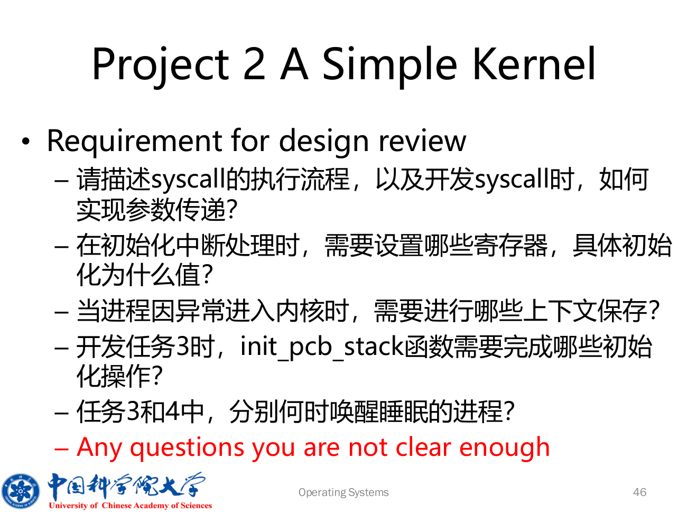

### 📄 原文翻译

> **Project 2 – 一个简易内核**
> • **设计评审要求**
> 　– 请描述 syscall 的执行流程，以及开发 syscall 时，如何实现**参数传递**？
> 　– 在初始化中断处理时，需要设置**哪些寄存器**，具体初始化为**什么值**？
> 　– 当进程因异常进入内核时，需要进行**哪些上下文保存**？
> 　– 开发任务 3 时，`init_pcb_stack` 函数需要完成哪些初始化操作？
> 　– 任务 3 和 4 中，**分别何时**唤醒睡眠的进程？
> 　– 你还有什么不清楚的问题吗？（红色强调）

### 💡 讲解

**下半场的 6 个问题**，全部围绕任务 3、4。逐题点出考点：

| # | 问题 | 考点关键词 | 本笔记对应页 |
|---|---|---|---|
| 1 | syscall 执行流程 + **参数传递** | `ecall` → `scause=8` → `handle_syscall` → 查系统调用表 → `sepc+4`；参数**通过寄存器 `a0–a7` 传**，系统调用号放 `a7` | P38, P39 |
| 2 | 中断初始化设置哪些寄存器、什么值 | `stvec = exception_handler_entry`；`sie.STIE = 1`（任务4）；`sstatus.SIE = 1`（任务4）、`SPIE = 1`、`SPP = 0` | P32, P33, P34, P37 |
| 3 | 进程因异常进内核保存哪些上下文 | **全量 32 个 GPR + `sstatus` + `sepc`**（→ `regs_context_t`）；对比 `switch_to` 只存 callee-saved | P13, P15 |
| 4 | 任务 3 的 `init_pcb_stack` 做什么 | 在 `regs_context_t` 里设 `sp = user_stack`、`sepc = entry_point`、`sstatus`（`SPP=0`,`SPIE=1`）；`switchto_context_t` 的假现场 | P13, P34 |
| 5 | 任务 3 / 4 何时唤醒睡眠进程 | 任务 3：**只有 `do_scheduler` 被调用时**（靠进程主动 yield）；任务 4：**每次定时器中断**都会检查 | P42, P41 |
| 6 | 自由提问 | —— | |

⚠️ **第 1 题的"参数传递"是本课程的一个关键设计**（任务书任务 3 步骤 7）：
> "实现 `tiny_libc/syscall.c` 中的 `invoke_syscall`，需要完成的内容为：使用**嵌入式汇编**，将参数放入对应的寄存器后调用 `ecall` 指令发起一次系统调用。"

**RISC-V 系统调用的约定**（沿用函数调用 ABI）：
- **系统调用号**放在 **`a7`**（R7）
- **参数**依次放在 **`a0`、`a1`、`a2`…**（最多 6 个）
- **返回值**放在 **`a0`**

所以用户态的 `invoke_syscall` 大概长这样：
```c
// 伪代码
register long a7 asm("a7") = syscall_num;
register long a0 asm("a0") = arg0;
...
asm volatile("ecall" : "+r"(a0) : "r"(a7), ... : "memory");
```
内核态收到后，从保存好的 `regs_context_t` 里**读出 `a0–a7`** 就能拿到参数和调用号。

📌 **课件的最后一行是红色的**：`Any questions you are not clear enough`（"你还有什么不清楚的问题吗"）——说明老师**鼓励提问**。Lecture 1 P29 的 Tips 也给了提问礼仪：
> "请先思考并试着清楚地描述你的问题"、"**请不要只给我们看一张截图**"、"提问之前请先自己 Google / 问 LLM"、"和同学讨论"

---

# 第四部分 · 收尾（P47–P48）

---

## P47

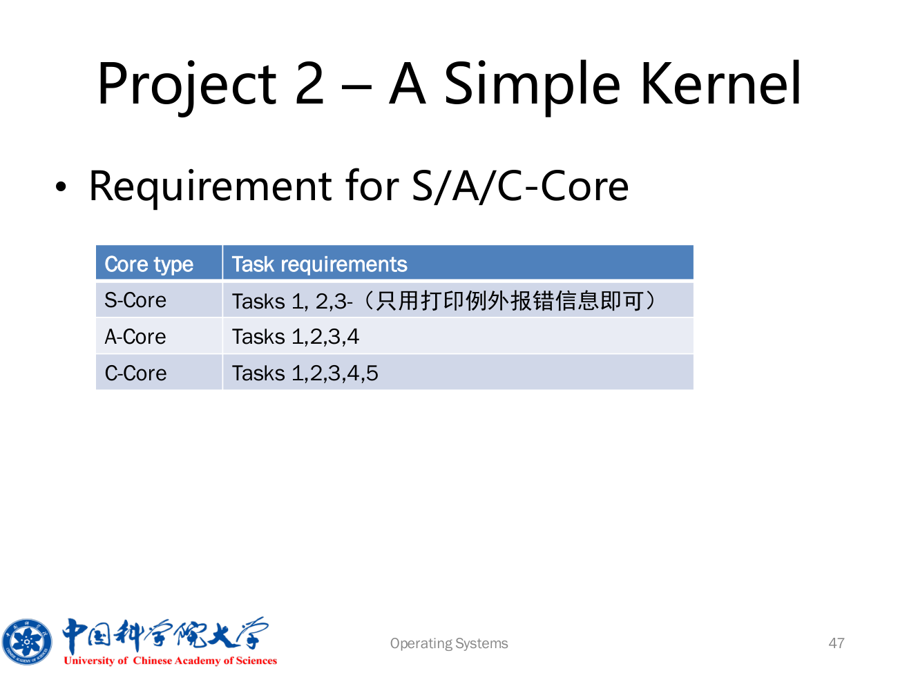

### 📄 原文翻译

> **Project 2 – 一个简易内核**
> • **S / A / C-Core 的要求**

| Core 类型 | 任务要求 |
|---|---|
| **S-Core** | 任务 1、2、3-（**任务 3 只需打印例外报错信息即可**）|
| **A-Core** | 任务 1、2、3、4 |
| **C-Core** | 任务 1、2、3、4、5 |

### 💡 讲解

**★ 分级是"叠加"的，不是"选做"的 ★**

任务书开头的"Project 2 功能总结"说得很清楚：
> "注意随着评分等级升高，需要完成的功能是**叠加**的，随着同时运行的进程不断增多，对操作系统稳定性的要求就也越高。也就是说，做 C-core 的同学需要完成下面列出的**所有**任务，让包括这些功能的进程**同时**运行。"

**各级别的具体差异**：

| | S-Core | A-Core | C-Core |
|---|---|---|---|
| 任务 3 的系统调用 | ❌ 只打印例外信息 | ✅ 完整实现 | ✅ 完整实现 |
| 特权级分离 | ❌ 一直用跳转表 | ✅ 有 | ✅ 有 |
| 定时器中断 / 抢占 | ❌ | ✅ | ✅ |
| 复杂调度算法 | ❌ | ❌ | ✅ |
| `loadbootd` 检查 | 不需要 | **需要** | **需要** |

**任务 3S（S-Core 版任务 3）的要求**（任务书 5.3）：
> "在例外发生时只**打印报错信息**，不需要例外的返回。这里的报错信息需要包括**发生例外的指令地址**（`sepc`）以及**出错的地址**（`stval`）。"

S-core 为什么也要做这个？任务书解释道：
> "S-Core 正常情况下是不需要例外处理的，但是不能排除仍然会有没考虑到的各种软、硬件的例外发生，如果不进行例外处理，操作系统一般会直接'**跑飞**'了。"

📌 **分数带**（Lecture 0 P17）：S-Core 0~70 / A-Core 71~85 / C-Core 86~100。

---

## P48

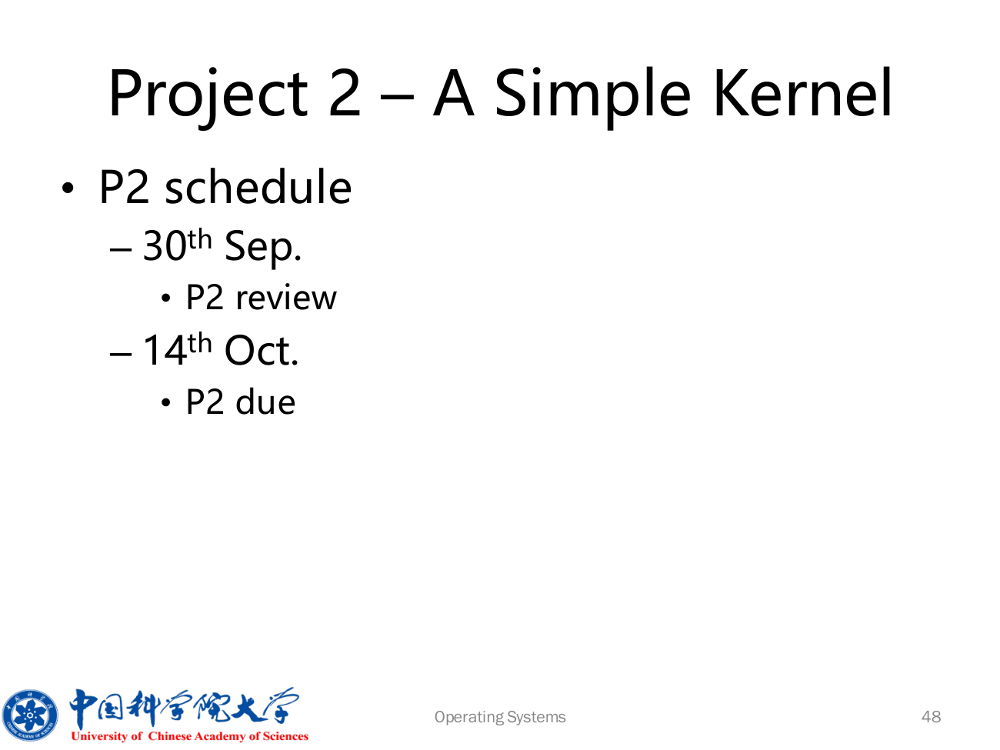

### 📄 原文翻译

> **Project 2 – 一个简易内核**
> • **P2 时间表**
> 　– **9 月 30 日**：P2 design review（设计评审）
> 　– **10 月 14 日**：P2 due（截止）

### 💡 讲解

**⚠️ 两个硬日期。**

- **9 月 30 日（周三）** —— **设计评审**。Lecture 0 P14 的规定：**不参加设计评审，本项目最高只能拿 60 分。**
- **10 月 14 日（周三）** —— **提交截止**。提交内容包括：
  - 源代码 + README（提交到 gitlab，用 `git tag` 标识提交）
  - **一份记录调试过程中经验教训的文档（页数不限）**
  - 提交网站：http://8.152.206.202/

📌 **延期的规则**（Lecture 0 P20）：
| 情况 | 规则 |
|---|---|
| S-Core 迟交 | 不扣分 |
| A-Core 迟交 | 允许延一周，但最高只能拿 80 分 |
| **C-Core** | **不允许延期** |

⚠️ 主人选的是 **C-Core**，所以 **10 月 14 日是不可谈判的硬截止**。

📌 **设计评审的形式**（Lecture 0 P15）：
> "每组一个学生（One student per group）"、"每个 project 重新分组"、"随机分组"、"**个人独立提交和演示**"

也就是说，**设计评审是 1 对 1（或多对 1）的口头答辩**，你要**自己**把机制讲清楚。Lecture 0 P21 的规定也要记住：
> "你可以向 AI 求助，但你**必须理解你写的每一行代码**。"

📌 **一位前辈的经验**（Lecture 0 P23，老师给的忠告）：
- 想清楚、设计好**再**写代码
- 尽可能**早开始**，不要被 ddl 追着跑
- 在设计评审前准备好第一版设计，和助教讨论
- 学会用工具，比如 `gdb + qemu`
- **鼓励增量式 git commit**
- xv6 可能对你有帮助

---

# 附录 A · Design Review 问题总表

**上半场（P23，针对任务 1、2）**

1. `switch_to` 函数的工作机制是怎样的？是如何支持两个进程的上下文切换的？
2. 你在初始化 PCB 和内核栈时需要做哪些事情？
3. 你在 `switchto_context_t` 中会保存哪些内容？
4. 请介绍你设计的内核调度器（`do_scheduler`）的工作流程。
5. 当一个进程被阻塞时，内核会进行哪些处理？

**下半场（P46，针对任务 3、4）**

6. 请描述 syscall 的执行流程，以及开发 syscall 时，如何实现参数传递？
7. 在初始化中断处理时，需要设置哪些寄存器，具体初始化为什么值？
8. 当进程因异常进入内核时，需要进行哪些上下文保存？
9. 开发任务 3 时，`init_pcb_stack` 函数需要完成哪些初始化操作？
10. 任务 3 和 4 中，分别何时唤醒睡眠的进程？
11. 你还有什么不清楚的问题吗？

---

# 附录 B · 课件中反复出现的文件路径速查

| 路径 | 出现在 | 作用 |
|---|---|---|
| `include/os/sched.h` | P6, P7, P15, P18 | `pcb_t`、`switchto_context_t`、`pid0_pcb` |
| `kernel/sched/sched.c` | P11 | `do_scheduler()`、`do_block()`、`do_unblock()`、`do_sleep()` |
| `kernel/mm/mm.c` | P8 | `allocKernelPage`、`allocUserPage` |
| `arch/riscv/kernel/entry.S` | P15, P32 | `switch_to`、`enable_preempt` |
| `arch/riscv/kernel/trap.S` | 任务书任务 3/4 | `setup_exception` |
| `arch/riscv/kernel/irq.c` | 任务书任务 3/4 | `init_exception`、`handle_irq_timer`、`exc_table`、`irq_table` |
| `kernel/lock/lock.c` | 任务书任务 2 | `init_locks`、`do_mutex_lock_*` |
| `kernel/sched/time.c` | P40, P41 | `get_timer` 等计时函数 |
| `include/os/bios.h` | P41 | `bios_set_timer` |
| `drivers/screen.c` | 任务书附录 | `screen_write`、`screen_reflush` |
| `tiny_libc/include/unistd.h` | P25 | 用户态系统调用 API |
| `tiny_libc/syscall.c` | P25, 任务书 | `invoke_syscall`、`sys_yield` 等 |
| `tiny_libc/include/syscall.h` | 任务书 | 用户态系统调用号定义 |
| `arch/riscv/include/asm/unistd.h` | 任务书 | 内核态系统调用号定义 |
| `arch/riscv/crt0/crt0.S` | P1 相关 | 用户程序 C 运行环境初始化 |

> ⚠️ **两处系统调用号必须一致**（任务书任务 3 注意事项 4）：
> "`start code` 给出的系统调用号的定义在 `arch/riscv/include/asm/unistd.h`（内核使用）和 `tiny_libc/include/syscall.h`（用户使用）中，大家要**新增系统调用号的话，注意保证两个文件内的调用号一致**。"

---

# 附录 C · 本项目的 6 个"必踩坑"速查

| # | 坑 | 症状 | 出处 |
|---|---|---|---|
| 1 | `tp` 与 `current_running` 不同步 | 现场错存到别的进程，跑飞 | P15 / 任务书任务1 步骤2 |
| 2 | `sepc` 没 +4 | 系统调用死循环，卡死在 `ecall` | P39 |
| 3 | `sstatus.SPP` 设成 1 | 进程跑在 S 态，`ecall` 跑到 M 态，系统调用不触发 | P34 |
| 4 | 定时器中断处理里忘了重设 timer | 定时器只触发一次，抢占失效，飞机卡住 | P41 |
| 5 | 睡眠进程没从就绪队列摘除 | 进程被反复调度却什么都不做，其他进程进度被拖慢 | P19, P20, P40 |
| 6 | 用户代码越界访问内核地址 | `loadbootd` 下触发 DASICS 例外；不带 `d` 时静默错误 | P45 |

---

*本笔记由课程 PDF 逐页翻译整理而成。翻译力求准确，讲解部分参考了 `guide_book_p2.pdf` 任务书第二章与 `P2start-code和pynq板卡启动.pdf`。凡涉及具体字段名、函数签名、寄存器初值的地方，请务必以你自己的 start-code 为准。*
